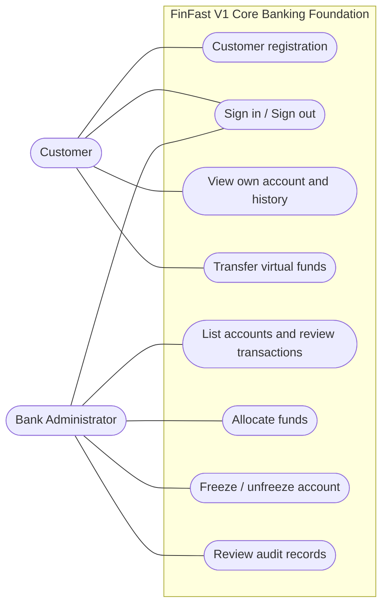

# 03 — Actors and Stakeholders

> **Stage:** Phase 1 — Domain Discovery\
> **Status:** Approved V1 actors — project owner baseline\
> **Version:** 1.0 | **Last updated:** 2026-10-16

> **Source transition:** Durable actor and journey summaries are maintained in [product vision](../product/vision.md) and [product requirements](../product/prd.md). This approved source remains operative for the detailed actor capabilities, restrictions, role boundary, and actor-to-use-case traceability until those obligations are explicitly reconciled into accepted OpenSpec specifications.

## 1. Purpose and system boundary

Identify **who interacts with FinFast V1 Core Banking Foundation**, why they interact, and what they are permitted to do. Only roles outside the software boundary are UML use-case actors. Background processing performed by FinFast Core is **internal system behavior**, not a separate external actor. V1 has only `CUSTOMER` and `ADMIN` application roles. Customer Web and Admin/Back-office are presentation channels, not new actors; they may share a responsive frontend with role separation.

## 2. Primary application actors

### ACT-01 — Customer

**Description:** A registered Customer with a linked User identity and one simulated-VND Customer Account.

**Goals:** Access their own virtual account, view balance/history, make internal transfers, inspect transfer results.

**Capabilities:**

- Register with display name, email, and password; authenticate and invalidate the authenticated session on logout.
- Read their own account details, available balance, and movement history.
- Transfer simulated funds **from their own account** to another active customer account.
- Inspect a transfer receipt/reference.

**Restrictions:** Cannot choose another Customer's source Account; cannot directly access/manage the Treasury Account or use it in Customer transfers; cannot allocate funds, change account status, see another Customer's private account/history, or acquire Admin privileges through registration. A frozen owner retains login and read-only access but cannot send or receive funds.

### ACT-02 — Bank Administrator

**Description:** Operator provisioned through a protected bootstrap/administrative process, using the separately authorized `ADMIN` role.

**Goals:** Enable repeatable demos and investigate abnormal or rejected operations.

**Capabilities:**

- View necessary Customer Account metadata: account number, customer identifier, limited display information, status, and balance.
- Allocate virtual VND from the internal treasury to an eligible customer account with a documented reason.
- Freeze/unfreeze Customer Accounts with a non-empty reason and an atomic success Admin Audit Event.
- View relevant transaction and administrative audit records.

**Restrictions:** Cannot directly overwrite balances, mint additional simulated funds, reset/replenish the treasury through normal application operations, or acquire Admin rights by self-registration. GENESIS is a controlled dataset-initialization procedure, not a normal Admin function. No V1 operation creates real money. Admin access excludes passwords and unnecessary sensitive information.

## 3. Non-actor stakeholders

| Stakeholder | Interest | Why not an application actor? |
|---|---|---|
| Project team | Maintain requirements, code, tests, and deployment | Developer access is an SDLC responsibility, not a banking role |
| Course lecturer/evaluator | Verify requirements, cloud behavior, and evidence | Observes a demonstration; may use a provided Customer/Admin demo login |
| Future support/operations role | Observe failures and audit trails | Separate operations role is not part of V1 auth model |

Controlled dataset initialization/recreation and administrator bootstrap are deployment responsibilities, not an additional banking application role or Customer/Admin self-service use case. The Treasury Account is a system-owned Account, not an actor.

## 4. Actor-to-use-case traceability

| Use case | Customer | Admin |
|---|:---:|:---:|
| UC-AUTH-01 — Register and provision account | ✓ | — |
| UC-AUTH-02 — Sign in / out | ✓ | ✓ |
| UC-ACC-01 — View account and balance | ✓ (own) | — (see UC-ADM-01) |
| UC-ACC-02 — View account history | ✓ (own) | — (see UC-ADM-04) |
| UC-TRF-01 — Initiate internal transfer | ✓ | — |
| UC-TRF-02 — View transfer receipt | ✓ (involved) | — (see UC-ADM-04) |
| UC-ADM-01 — List customer accounts | — | ✓ |
| UC-ADM-02 — Allocate demo funds | — | ✓ |
| UC-ADM-03 — Freeze or unfreeze account | — | ✓ |
| UC-ADM-04 — Review financial movements and audit events | — | ✓ |

See detailed flows in [04 — Use Case Catalogue](./04-use-cases.md).

## 5. Conceptual actor/use-case map

> Mermaid flowchart (not a strict UML notation). Use PlantUML for formal UML if the course requires it.

## 6. Approved permission and ownership rules

- Customers register with customer role only (`BR-ID-02`).
- Authorization is enforced **server-side**, even if the UI hides unauthorized controls (`BR-ID-02`, `BR-TRF-02`).
- A Customer only views history if their account is the source or destination (`BR-HIS-02`).
- Admin access is narrower than unrestricted database access: actions must pass domain rules and be audited (`BR-ADM-01`, `BR-ADM-03`).
- Application account freeze does **not** disable customer authentication; the customer may still inspect previous transactions (A-011).
- Treasury access is restricted to explicitly authorized operations (`BR-ACC-05`, `BR-ADM-05`); Admin data access is limited to operational need (`BR-ADM-06`).

## 7. Resolved actor decisions

- `OQ-001` — CLOSED: necessary account/customer metadata and authorized transaction/audit views only.
- `OQ-002` — CLOSED: only CUSTOMER and ADMIN roles; no separate Auditor or Support actor in V1.

Decision authority: project owner, 2026-10-16. External course requirements are tracked separately in [07](./07-assumptions-and-questions.md); no additional actor is assumed.

**Product summaries:** [Product vision](../product/vision.md) · [Product requirements](../product/prd.md)

**Operative behavior:** [04 - Use Cases](./04-use-cases.md) · [06 - Business Rules](./06-business-rules.md) · [07 - Open Questions](./07-assumptions-and-questions.md)
