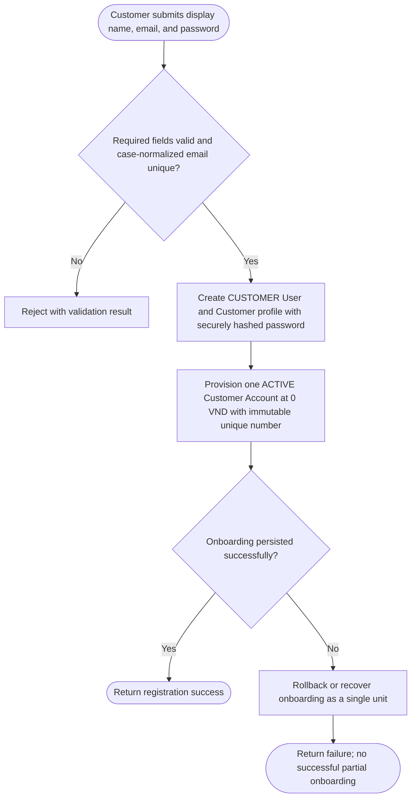
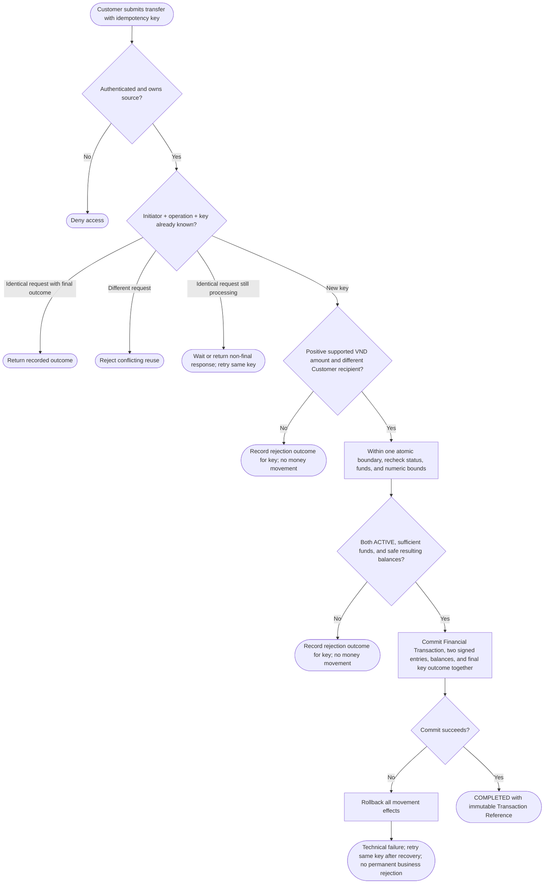
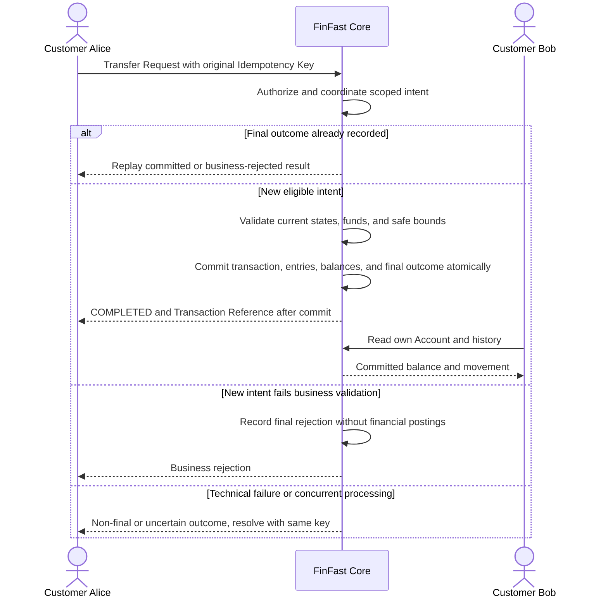
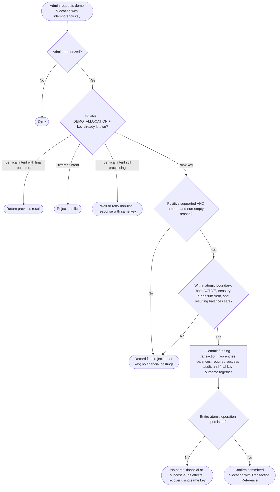
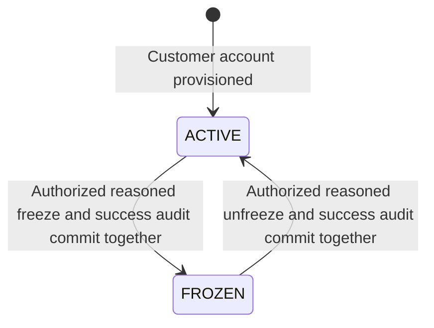
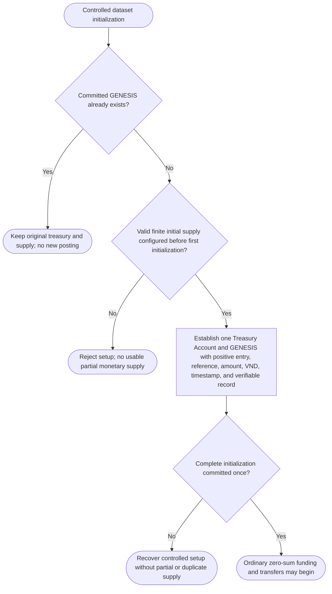

# 05 — Business Process Flows

> **Stage:** Phase 1 — Domain Discovery\
> **Status:** Approved V1 business flows — project owner baseline, not physical architecture\
> **Version:** 1.0 | **Last updated:** 2026-10-16

## 1. Purpose

Visualize the key **end-to-end behaviors** of FinFast V1 Core Banking Foundation before designing APIs and services. Mermaid diagrams are stored as source-controlled text. **FinFast Core / System** represents logical banking responsibilities, independent of presentation channels; no service, class, schema, or transaction-lock implementation is prescribed.

## 2. BP-01 — Registration and account provisioning

**Use case:** `UC-AUTH-01`\
**Outcome:** A registered customer has exactly one ACTIVE VND account, initially holding zero virtual funds.



**Key rules:** `BR-ID-01`, `BR-ID-02`, `BR-ACC-01`, `BR-ACC-05`, `BR-ACC-06`, `BR-SIM-02`. No real identity documents or banking credentials are collected. The technical design decides how to guarantee complete onboarding and prevent concurrent duplicates; there is no Admin self-registration.

## 3. BP-02 — Customer-to-customer internal transfer

**Use case:** `UC-TRF-01`\
**Outcome:** A committed Financial Transaction or final business rejection. A technical failure/non-final response remains safely resolvable using the original Idempotency Key; it is not a permanent business outcome.



Final business-rejection outcomes are recorded for the dataset lifetime. Replaying an identical scoped key returns the original rejection even after balances/status change; a fresh business attempt needs a new key. Replay follows current authorization checks but precedes revalidation of mutable business conditions. Concurrent identical intent is coordinated so it cannot post twice. Failure to durably record an outcome is a recoverable technical failure, not a falsely recorded final business rejection.

A **lost client response after successful commit** is not a rollback: the Financial Transaction stays committed. The client retries with the **same key** or uses an authorized result lookup, even when it never received the Transaction Reference. No complex persisted transfer state machine is required.

### Logical interaction sequence



**Critical invariant:** for positive Transfer Amount `200000 VND`:

```text
Source Ledger Entry Delta:      -200000 VND
Destination Ledger Entry Delta: +200000 VND
Sum of ordinary movement deltas:      0 VND
```

This applies to both Customer transfers and treasury allocations: exactly two entries, with no fee. It **does not** apply to GENESIS, which has one positive treasury entry and establishes initial supply. A rejected request has no posted entries.

**Key rules:** `BR-TRF-01`–`BR-TRF-12`, `BR-ACC-02`–`BR-ACC-05`, `BR-LED-01`–`BR-LED-04`, `BR-LED-06`. Active state, funds, and numeric bounds are revalidated within the same concurrency-safe boundary used for commit.

## 4. BP-03 — Administrator demo fund allocation

**Use case:** `UC-ADM-02`\
**Outcome:** Transfer a positive amount **from** finite demo treasury **to** an ACTIVE customer account; log who authorized it and why. Require a retry-safe request key so double submissions cannot allocate twice.



**Atomicity note:** Required success audit includes administrator, action, target, non-empty reason, timestamp, outcome, and Transaction Reference. Its persistence is part of the financial operation, not a later best-effort step. Any failure in ledger, balance, required success audit, or final outcome persistence prevents a successful partial allocation. Separate rejected/unauthorized operational evidence creates no financial postings. Final rejections replay even when conditions change; technical failures do not become permanent business rejections. A lost response follows BP-02 recovery.

**Initialization note:** Funding requires the single finite Treasury Account initialized by BP-06. It never directly overwrites Customer balances, exceeds treasury available balance, or creates additional supply. No normal reset/replenishment operation exists.

**Key rules:** `BR-ADM-01`–`BR-ADM-05`, `BR-ACC-02`–`BR-ACC-05`, `BR-TRF-04`, `BR-TRF-05`, `BR-TRF-06`, `BR-TRF-10`–`BR-TRF-12`, `BR-LED-03`–`BR-LED-06`.

## 5. BP-04 — Freeze and unfreeze customer account

**Use case:** `UC-ADM-03`\
**Outcome:** Authorized Customer Account status change and required success Admin Audit Event commit atomically, with a non-empty reason. Missing reason rejects; repeating the existing status returns `UNCHANGED`, causes no financial movement, and may record the attempted operation. Treasury is excluded from this control. Owners retain authentication and read-only access; new transfers/funding cannot send to or receive from FROZEN Accounts.



**Concurrency note:** Freeze/unfreeze and transfer/funding must enforce a consistent effective order. If freeze takes effect first, no new movement involving that Account may commit. If the movement commits first, it remains valid when the later freeze takes effect. Checking ACTIVE only before entering the commit boundary is insufficient. If required audit persistence fails, the status change does not take effect. A replay of an already committed movement is not a new posting and remains readable after freeze. The coordination mechanism belongs to technical design.

**Key rules:** `BR-ACC-02`, `BR-ADM-03`.

## 6. BP-05 — History and audit visibility

**Use cases:** `UC-ACC-02`, `UC-TRF-02`, `UC-ADM-04`.

1. Customer authenticates and requests only **their own** account history.
2. Application authorizes account/transaction ownership.
3. Application presents committed movements as incoming/outgoing history with positive amount and direction, type, timestamp, counterparty, and immutable Transaction Reference. Deterministic newest-first pagination is required: default 20, maximum 100 per page, stable continuation even with equal timestamps/new commits; financial history lasts for the dataset lifetime.
4. Admin views restrict information to authorized operational need. Admin Audit Events (administrator, timestamp, target, action, non-empty reason, outcome, and reference or before/after state) are separate from financial history and request outcomes. Rejected requests never appear as committed money movements; GENESIS appears as an explicitly labeled initialization in authorized financial inspection, not Customer history.
5. Failed authorization never reveals another customer's private transaction details.

**Key rules:** `BR-HIS-01`–`BR-HIS-04`, `BR-LED-01`–`BR-LED-03`, `BR-ADM-03`, `BR-ADM-06`.

## 7. BP-06 — Controlled treasury GENESIS

**Use-case relationship:** Operational prerequisite for `UC-ADM-02`; initialization evidence is inspectable through `UC-ADM-04`. This is controlled dataset setup, not an Admin self-service money-creation capability or a new banking actor.

**Outcome:** One system-owned Treasury Account with one committed `GENESIS` transaction and one positive treasury entry. Initial supply defaults to **100,000,000 VND**; a valid finite positive VND amount within supported bounds may be configured before the first initialization.



The once-only guarantee must also hold under concurrent setup attempts. Restart or changing configuration on an existing dataset cannot alter supply. Reset is separately controlled dataset recreation, never an ordinary mint/reset API. After GENESIS:

```text
Account balance = sum(committed signed Ledger Entry Deltas for that Account)
                 (include the treasury GENESIS entry exactly once)
Treasury balance + sum(all Customer Account balances) = initial GENESIS supply
```

**Key rules:** `BR-ACC-03`–`BR-ACC-06`, `BR-LED-01`–`BR-LED-05`, `BR-ADM-02`, `BR-ADM-05`.

## 8. Boundary cases to verify in acceptance

| Situation | Expected V1 business outcome |
|---|---|
| Two customer transfers spend same balance concurrently | Only transfers that fit actual available balance may commit |
| Response lost after successful commit | Retry same idempotency key; no second transfer |
| Source frozen during transfer | Commit order determines outcome; if freeze is effective first, reject transfer |
| Customer becomes frozen after a transfer | Previously committed transfer stays in history |
| Treasury runs out of demo funds | Admin allocation rejected without creating virtual money |
| Server crashes before transaction commits | No partial financial effects |
| Account history is empty | Show an empty state, not a fabricated transaction |
| Identical requests arrive concurrently | Coordinate the same scope; at most one committed movement; wait or retry safely |
| Rejected intent retried after balance/status changes | Replay its final rejection; only a new key creates a new attempt |
| Required success Admin audit cannot persist | No funding or Account status change commits |
| Transfer Amount or resulting balance overflows | Reject with no financial effects |
| Simultaneous opposite-direction transfers | Both eligible intents reach a valid final outcome with no lost funds or indefinite unresolved processing |
| GENESIS attempted again or application restarts | Preserve the existing treasury, initial supply, and initialization reference |
| Reconcile all accounts after mixed operations | Balances match signed entries; total balances equal initial supply |

Canonical acceptance IDs and their CONS risk mappings are in [04](./04-use-cases.md#4-acceptance-scenario-matrix) and [06](./06-business-rules.md#7-high-risk-consistency-scenarios).

**Related:** [04 — Use Cases](./04-use-cases.md) · [06 — Business Rules](./06-business-rules.md)
