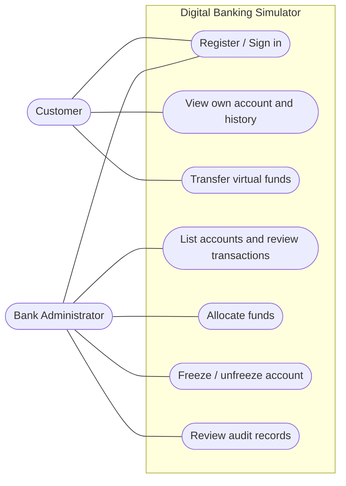

# 03 — Actors and Stakeholders

> **Stage:** Phase 1 — Domain Discovery  
> **Status:** Working draft  
> **Version:** 0.1 | **Last updated:** 2026-10-14

## 1. Purpose and system boundary

Identify **who interacts with the Digital Banking Simulator**, why they interact, and what they are permitted to do. Only roles outside the software boundary are UML use-case actors. Background processing performed by our own backend is **internal system behavior**, not a separate external actor.

## 2. Primary application actors

### ACT-01 — Customer

**Description:** A registered retail user of the simulated bank.

**Goals:** Access their own virtual account, view balance/history, make internal transfers, inspect transfer results.

**Capabilities:**

- Register a customer identity; authenticate and terminate a session.
- Read their own account details, available balance, and movement history.
- Transfer simulated funds **from their own account** to another active customer account.
- Inspect a transfer receipt/reference.

**Restrictions:** Cannot choose another user's source account; cannot allocate treasury money, change account status, see another customer's private history, or impersonate an admin.

### ACT-02 — Bank Administrator

**Description:** Pre-provisioned operator of the educational simulator, using a separately authorized administrative role.

**Goals:** Enable repeatable demos and investigate abnormal or rejected operations.

**Capabilities:**

- View customer accounts and statuses.
- Allocate virtual VND from the internal treasury to an eligible customer account with a documented reason.
- Freeze/unfreeze customer accounts.
- View relevant transaction and administrative audit records.

**Restrictions:** Cannot directly overwrite arbitrary balances; cannot create real money except through the **one-time initial treasury genesis** performed by controlled initialization; cannot use a self-service registration flow to acquire admin rights.

## 3. Non-actor stakeholders

| Stakeholder | Interest | Why not an application actor? |
|---|---|---|
| Project team | Maintain requirements, code, tests, and deployment | Developer access is an SDLC responsibility, not a banking role |
| Course lecturer/evaluator | Verify requirements, cloud behavior, and evidence | Observes a demonstration; may use a provided Customer/Admin demo login |
| Future support/operations role | Observe failures and audit trails | Separate operations role is not part of V1 auth model |

## 4. Actor-to-use-case traceability

| Use case | Customer | Admin |
|---|:---:|:---:|
| UC-AUTH-01 — Register and provision account | ✓ | — |
| UC-AUTH-02 — Sign in / out | ✓ | ✓ |
| UC-ACC-01 — View account and balance | ✓ (own) | — (see UC-ADM-01) |
| UC-ACC-02 — View account history | ✓ (own) | — (see UC-ADM-04) |
| UC-TRF-01 — Initiate internal transfer | ✓ | — |
| UC-TRF-02 — View transfer receipt | ✓ (involved) | — (see UC-ADM-04) |
| UC-ADM-01 — List customer accounts | — | ✓ |
| UC-ADM-02 — Allocate demo funds | — | ✓ |
| UC-ADM-03 — Freeze or unfreeze account | — | ✓ |
| UC-ADM-04 — Review financial movements and audit events | — | ✓ |

See detailed flows in [04 — Use Case Catalogue](./04-use-cases.md).

## 5. Conceptual actor/use-case map

> Mermaid flowchart (not a strict UML notation). Use PlantUML for formal UML if the course requires it.

## 6. Permission and ownership assumptions

- Customers register with customer role only (`BR-ID-02`).
- Authorization is enforced **server-side**, even if the UI hides unauthorized controls (`BR-ID-02`, `BR-TRF-02`).
- A Customer only views history if their account is the source or destination (`BR-HIS-02`).
- Admin access is narrower than unrestricted database access: actions must pass domain rules and be audited (`BR-ADM-01`, `BR-ADM-03`).
- Application account freeze does **not** disable customer authentication; the customer may still inspect previous transactions (A-011).

## 7. Questions to validate

- Should the admin be allowed to view the **full** customer profile or only minimal account metadata? (`OQ-001`)
- Does the course require a distinct support or auditor role? (`OQ-002`)

**Related:** [04 — Use Cases](./04-use-cases.md) · [06 — Business Rules](./06-business-rules.md) · [07 — Open Questions](./07-assumptions-and-questions.md)
