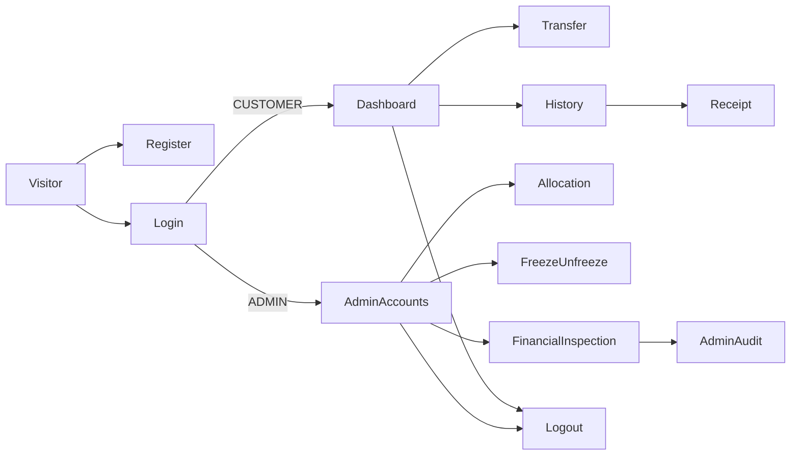

# 14 — V1 Customer/Admin Experience, Wireframes and E2E Journeys

> **Approval — 2026-10-22:** Tiến approves the existing information architecture, S01–S10 capabilities/states, WEB-01..08 execution specifications and PRD viewport/zoom/keyboard checks as the V1 implementation baseline. [Approval record](../6-governance/25-design-decision-register.md#2026-10-22--v1-product-ux-and-rest-contract-freeze). Follow TD-001/003/004/006/008 and the frozen OpenAPI. Browser execution remains NOT YET VERIFIED; no WCAG certification is claimed.

> Status: **APPROVED — V1 UX FLOW AND ACCEPTANCE DESIGN BASELINE**. Preserve FR-001..013, UX-001..005 and canonical AC-038. Customer and Admin may share one frontend with strict role separation. No native mobile app or additional banking feature is authorized.

## Information architecture



## Screen inventory and minimum states

| Screen | Primary actions/content | Required states and key safeguards | PRD trace |
|---|---|---|---|
| S01 Registration | Name, email, password; submit | validation, duplicate email, pending, failure, success; **no Admin role selector** | FR-001, UX-001/003 |
| S02 Login/Logout | Credentials and explicit sign-out | wrong credentials, pending, expired/revoked session, role separation | FR-002, UX-001/002 |
| S03 Customer dashboard | Account Number, balance, currency, ACTIVE/FROZEN status | zero, funded, frozen READ-ONLY; no treasury detail | FR-003, UX-001 |
| S04 Transfer form | Recipient Number, integer VND amount, optional note, submit | invalid, insufficient, self/frozen/unknown, submitting, **unknown/processing**, committed | FR-004/006, UX-001/003/004 |
| S05 Financial history | Newest-first entries, direction/type, references, paging | empty, loading, forbidden, 20/default and ≤100/max, tie/concurrent stability | FR-007, UX-001/003 |
| S06 Receipt | Immutable committed type/ref/amount/time/counterparty/status | unknown/not-permitted does not expose private facts | FR-008 |
| S07 Admin account list | Minimal Customer metadata, status, balance, account selection | denied Customer, empty list, no secrets or treasury balance | FR-009, UX-002 |
| S08 Admin allocation | Target, positive amount, nonempty reason; submit | insufficient treasury, frozen target, conflict, lost response; same-key retry | FR-011/006, UX-002/004 |
| S09 Admin freeze/unfreeze | Target, desired ACTIVE/FROZEN, reason | CHANGED/UNCHANGED, audit-persistence failure, concurrent movement | FR-012, UX-002/003 |
| S10 Admin inspection | Transactions/ledger vs audits in separate views | GENESIS explicitly initialized, no rejected requests as finance; limited data | FR-013, UX-002 |

## Low-fidelity layouts (not final design system)

These ASCII wireframes are **LOW-FIDELITY REFERENCES**, not pixel-perfect mandatory layouts. Frontend owner Sĩ may choose styling, colors, typography, layout composition, component library, animations and responsive presentation details without further architecture approval, within the approved task/dependency process. Preserve every screen capability, required state/action, safe financial recovery, server-enforced authorization, responsive/accessibility checks and frozen REST contract. No framework or UI dependency is mandated here.

```text
+--------------------- FINFAST | CUSTOMER ----------------------+
| Account Overview             [History] [Transfer] [Logout]   |
| Account No: XXXX-1234       Currency: VND                     |
| Status: ACTIVE              Balance: 800,000 VND              |
|                                                               |
| Recent Committed Movements                                   |
| [out] -200,000 | INTERNAL_TRANSFER | REF... | View receipt   |
| [in ] +1,000,000 | DEMO_ALLOCATION | REF... | View receipt   |
|                                      [Previous] [Next]        |
+---------------------------------------------------------------+

+--------------------- TRANSFER -------------------------------+
| Destination Account Number [____________]                     |
| Amount (whole VND)         [____________]                     |
| Note (optional)            [____________]                     |
| [Submit transfer]                                              |
| [Unknown outcome: checking original request... Retry safely] |
| [Completed: REF...]                                           |
+---------------------------------------------------------------+

+--------------------- FINFAST | ADMIN -------------------------+
| Accounts | Allocate | Freeze/Unfreeze | Finance | Audit       |
| Account No. | Customer | Status | Balance | Allowed actions   |
| [...]                                                       |
| Allocation requires [target] [VND amount] [reason] [submit]    |
| Financial movements ≠ Admin Audit ≠ Request outcomes         |
+---------------------------------------------------------------+
```

## UX rules for uncertainty (mandatory, not merely visual polish)

1. Generate a client idempotency key for a **new user intent**, store it in current UI state until the final response is resolved, and send it on any retry.
2. Disable accidental repeated creation of new keys while the first intent is submitting/resolving; a disabled button is *not* the backend duplicate defense.
3. On `COMPLETED`, show the committed immutable reference and provide receipt link; refresh owned balance/history.
4. On final business rejection, show reason, and explain a deliberately new attempt must use a new key. Do not retry the old rejected intent hoping funds change.
5. On timeout/network error/non-final response, show **Outcome unknown**; keep key/payload and offer safe resolution. Never present a timeout as certain failure or generate a new key as default recovery.
6. Display `FROZEN` as read-only access with explanation; do not imply user credentials were revoked.
7. Announce validation and outcome text clearly; support keyboard-only actions, visible focus and responsive layout without horizontal content loss.

## Browser E2E journey scripts (approved execution specifications, canonical AC references preserved)

WEB-01..08 are APPROVED test specifications and retain the canonical AC mappings below. Their execution/results are NOT YET VERIFIED; approval does not mark any scenario PASS.

| Test | Steps | Expected outcome | Canonical ACs |
|---|---|---|---|
| WEB-01 | Register Alice and Bob → sign in separately → dashboard | Each gets exactly one ACTIVE 0 VND Account, no credential exposure | AC-001/027/035/038 |
| WEB-02 | Admin login → account list → allocate 1,000,000 VND to Alice with reason | Treasury debit/customer credit and success audit; Alice dashboard funded | AC-008/030/038 |
| WEB-03 | Alice transfers 200,000 VND to Bob → history/receipts on both sessions | Alice 800,000; Bob 200,000; matching reference | AC-003/012/031/038 |
| WEB-04 | Trigger simulated lost response after commit → resolve same key | One posting; original reference recovered, no false failure | AC-005/011/033/038 |
| WEB-05 | Freeze Bob → Bob login/history; attempt send/receive/allocate → unfreeze | Read allowed, new movements rejected while frozen; fresh eligible key works after | AC-009/026/029/038 |
| WEB-06 | Alice tries Bob history/receipt; Customer tries Admin page/actions | No private disclosure or financial effect even via direct HTTP requests | AC-002/024/030/038 |
| WEB-07 | Navigate empty and >100-record history; add movements between pages | No duplicate/omitted eligible movements, proper page limit | AC-025/038 |
| WEB-08 | Customer/Admin pages on 360×800, 768×1024, 1440×900 plus 200% zoom/keyboard | Required flows, status text and controls usable; document browsers | AC-038 |

For backend acceptance, keep the original AC-001..AC-038 definitions in [04](../01-discovery/04-use-cases.md); WEB IDs are execution artifacts, not replacement policy.
