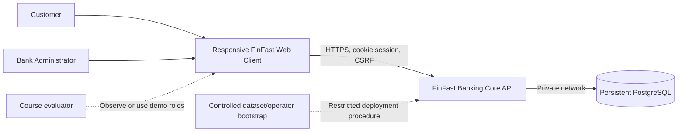
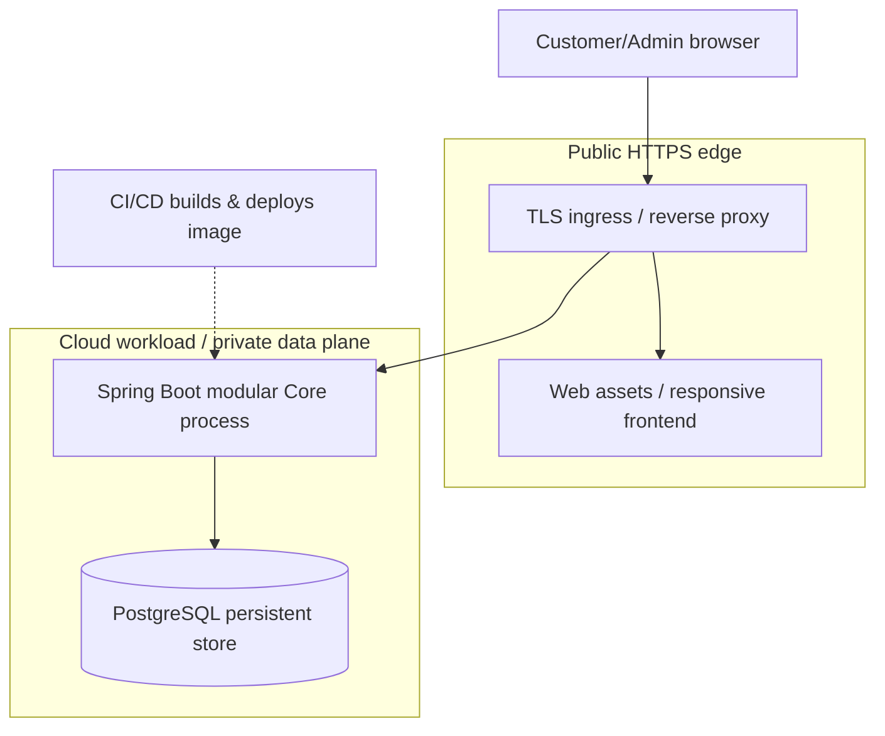
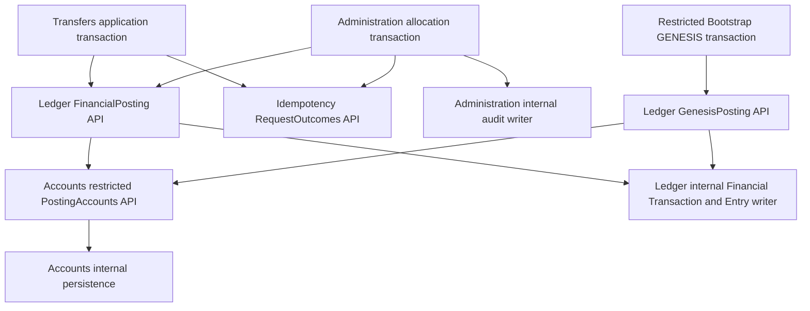
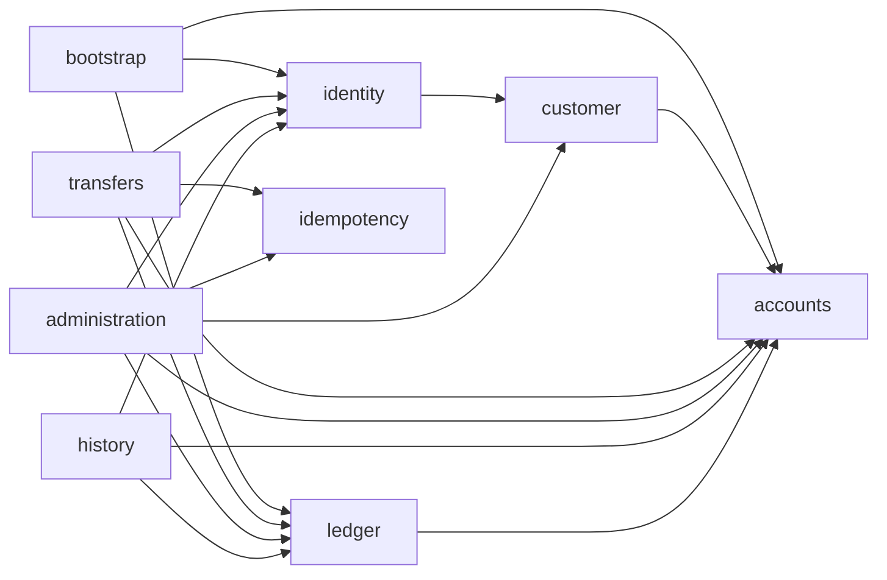

# 15 — System Context, Containers, Modules and Security Boundaries

> **AGREED architecture direction:** Java/Spring Boot, PostgreSQL, one deployable Modular Monolith, DDD-inspired domain modules, pragmatic Hexagonal Architecture, constructor-based Spring DI, in-process module calls, REST/OpenAPI/Swagger UI, protected server-managed sessions and PostgreSQL ACID transactions. This incorporates the Tech Lead's confirmed direction and preserves A-013 / DEC-006. Concrete business interfaces, dependency allowlist and transaction/locking mechanisms remain **PROPOSED** pending review. Backend/database/observability and branch-local shared contracts/architecture checks exist; the business modules and deployment design below are not implemented. See the [root README](../../README.md) for current status.

The Modular Monolith sets deployment and logical module boundaries. DDD gives each module ownership of its domain concepts and invariants. Pragmatic Hexagonal Architecture keeps business logic separate from HTTP and persistence adapters without requiring an interface for every class. One six-person team can work within these boundaries while financial operations still share one database transaction. No mandatory microservices, Kafka, Kubernetes, Redis, event sourcing, distributed transactions or separate module databases are introduced. Provider and infrastructure sizing await EV-001/002.

## 1. Context



**Boundaries:** browsers are untrusted; User ≠ Customer ≠ Account. CORE is the financial source of truth and enforces authorization on every read/mutation. Database connections are not exposed publicly. Admin bootstrap and GENESIS are controlled deployment/setup procedures, **not application features**.

## 2. Container view (C4-style, indicative)



- One deployable Core process, one logical PostgreSQL financial database. Hosting can use a managed container runtime, VM with Docker, or other provider subject to EV-001/002.
- Frontend can be static-hosted or bundled/served through Core; both are a delivery design choice. Distinguish physical deployment from domain modules.
- Health/readiness endpoints reveal no financial data. All secrets from protected configuration/secrets store, never repository or client bundle.

## 3. Module ownership and the controlled posting path

The following API names are **proposed design vocabulary**, not existing Java classes. Accounts owns balances and statuses; Ledger coordinates paired balance movements with immutable Financial Transactions and Ledger Entries. Transfers and Administration own their complete application transactions, including final request outcomes and required audit. Ledger never independently commits a debit or credit.

| Module | Owns | Proposed public API / permitted consumers |
|---|---|---|
| `identity` | User credentials, role policy, server sessions; registration orchestration | Authentication/authorization context for protected use cases; protected Admin provisioning for Bootstrap |
| `customer` | Customer profile and User linkage | Registration provisioning for Identity; limited customer metadata for Administration; calls Accounts to open one zero-balance Customer Account |
| `accounts` | Account identity, type, status, materialized balance and balance/status invariants | `AccountQueries` for authorized readers; `AccountProvisioning` for Customer/Bootstrap; `AccountStatusCommands` for Administration; restricted `PostingAccounts` for Ledger only |
| `transfers` | Customer transfer intent validation and orchestration | Customer transfer application entry; calls Ledger's `FinancialPosting` and Idempotency's `RequestOutcomes` |
| `ledger` | Financial Transactions, signed entries, immutable references, posting semantics, reconciliation and dataset posting order | `FinancialPosting` for Transfers/Administration; `LedgerQueries` for History/Administration; restricted `GenesisPosting` for Bootstrap only |
| `idempotency` | Durable full scoped identity, canonical intent, final result, coordination and recovery | `RequestOutcomes` for Transfers/Administration; authorized lookup accepts server-established initiator context, never an arbitrary user ID from the client |
| `administration` | Treasury allocation, account status orchestration, required Admin Audit Events | Authorized Admin use cases; calls Ledger for funding and Accounts for status; owns audit persistence inside the same transaction |
| `history` | Read-only history and receipt projections | Authorized reads through Accounts/Ledger APIs; no financial or account mutation |
| `bootstrap` | Restricted Admin provisioning and controlled GENESIS procedure | Operator/setup entry, no public HTTP API; calls Identity, Accounts and Ledger initialization APIs |

### 3.1 One financial posting path (ARC-01)



`FinancialPosting` offers distinct internal-transfer and demo-allocation intents. The caller supplies an authorized, typed intent; Ledger validates transaction type and account roles, obtains both locked Accounts through `PostingAccounts`, and requests the paired checked movement there. Accounts rechecks ACTIVE status, sufficient funds and numeric bounds on the locked values before changing either balance. Ledger creates the reference and exactly two equal-and-opposite entries. It returns a pending posting result to its caller **inside the existing transaction**; only the outer commit makes it a committed Financial Transaction. The allocation caller then writes the required audit and the final outcome before that same commit. See [16 §5](16-domain-model-and-data-design.md#5-transaction-boundaries-and-outcomes-arc-02).

Transfers may invoke only the internal-transfer operation; Administration only demo allocation. Enforce these method-level restrictions as well as package access, and verify CUSTOMER-to-CUSTOMER versus TREASURY-to-CUSTOMER account types within the posting operation. Callers cannot supply an arbitrary debit/credit delta or bypass owner/role authorization. Neither controller nor Transfers/Administration may import Accounts/Ledger repositories, write balance columns, or create ledger facts directly.

`PostingAccounts` is not a generic public balance setter. Its restricted operations apply a validated pair under locks, or initialize Treasury within the special GENESIS boundary. GENESIS is the sole one-entry positive initialization, guarded by dataset uniqueness and stable reference; it is not an ordinary zero-sum posting. Opening a Customer Account sets zero without creating money. Initialization APIs are unavailable to normal financial callers. Accounts owns their state validation, Ledger owns GENESIS facts, and Bootstrap encloses setup in one transaction.

### 3.2 Allowed module dependencies (ARC-06)

An arrow means an allowed Java dependency on the target's explicit public API, never its internals. This is an acyclic **proposed allowlist**; not every use case needs every arrow.



Identity registration orchestrates Customer provisioning and the zero-balance Account through Customer's API in one transaction. Accounts has no return dependency on Customer or Identity: ownership identifiers are values, not imported entities. Ledger does not depend on Transfers, Administration or Idempotency; its posting result lets those callers finish their own outcome/audit work. History authorizes reads before using projections; it cannot join private tables through another module's repository. Idempotency is independent of business modules and consumes a trusted initiator/operation context; current authorization is still checked before every lookup/replay. Audit writing stays within Administration, avoiding a Ledger → Administration cycle.

### 3.3 Java project and module structure (DOC-02)

One Spring Boot application, organized by domain first. The nine business packages
below are planned, not present scaffolding. Existing shared contracts and technical
infrastructure are under `com.finfast.common`:

```text
src/main/java/com/finfast/
├── FinfastApplication.java
├── identity/
├── customer/
├── accounts/
├── transfers/
├── ledger/
├── idempotency/
├── administration/
├── history/
└── bootstrap/
```

Representative business module (illustrative; create only packages needed by actual behavior):

```text
module/
├── api/
│   └── PublicModuleFacade.java
└── internal/
    ├── domain/
    │   ├── entity/
    │   ├── valueobject/
    │   ├── service/
    │   └── exception/
    ├── application/
    │   ├── dto/
    │   ├── port/
    │   │   ├── inbound/
    │   │   └── outbound/
    │   └── usecase/
    ├── adapter/
    │   ├── inbound/
    │   │   └── http/
    │   └── outbound/
    │       └── persistence/
    └── config/
```

| Area | Responsibility and dependency rule |
|---|---|
| `api` | Small cross-module facade/contracts and immutable boundary DTOs; no JPA entities or repositories. Separate named API groups may distinguish queries, posting and bootstrap privileges. |
| `internal/domain` | Entities, value objects and invariants; keep independent of Spring MVC, JPA and infrastructure where practical. Domain services exist only for domain behavior that does not belong on one entity/value. |
| `internal/application` | Use-case orchestration, transaction entry, application DTOs and meaningful ports. Calls domain logic and allowed module APIs; does not depend on HTTP/persistence implementations. |
| `application/port/inbound` | Optional use-case contract when a meaningful entry boundary is needed; avoid facade/port/use-case interfaces that merely duplicate each other. |
| `application/port/outbound` | Application-required persistence/infrastructure capabilities; implemented by adapters. |
| `adapter/inbound/http` | Thin controllers map HTTP input, authenticated context and result DTOs. They do not coordinate financial writes or decide transaction commit. |
| `adapter/outbound/persistence` | Implements ports, maps persistence entities and obtains PostgreSQL locks; owns module-local repositories. |
| `internal/config` | Spring wiring and adapter configuration via constructor injection; composition stays outside the domain. |

Use in-process calls between modules, not HTTP/gRPC, separate databases or distributed transactions. Spring wires implementations by constructor injection. Sharing a transaction does not permit sharing internal repository/entity classes. Application transaction annotations may couple orchestration to Spring; avoiding that practical coupling with numerous wrapper interfaces is not a V1 goal.

### 3.4 Enforcing the boundaries (ARC-06)

**Implemented on the Step 4E.2 working branch:** TEST-scope ArchUnit 1.5.1 with
`archunit-junit6`, matching Boot 4.1.1's managed Jupiter 6.0.3. These checks execute
through ordinary Maven tests; the §3.2 allowlist remains a **candidate**, not an
approved policy. Spring Modulith is not installed or required by this baseline.

- Only the nine named business modules are cycle nodes. `common`, the root launch
  class and libraries are excluded. Own-module internal access is permitted;
  cross-module dependencies require both a candidate edge and provider `api` access.
- [ProductionArchitectureTests](../../backend/src/test/java/com/finfast/architecture/ProductionArchitectureTests.java)
  scans compiled production code with test classes excluded. Rules cover cycles,
  domain/application isolation, controller JDBC/persistence access, clean business
  code and prohibition of shared-to-business dependencies. See the
  [implemented policy](../../backend/src/test/java/com/finfast/architecture/ModuleArchitectureRules.java).
- [RuleVerificationTests](../../backend/src/test/java/com/finfast/architecture/RuleVerificationTests.java)
  explicitly imports segregated test fixtures. Valid own/API/shared usage passes;
  foreign internals, reversed edges, cycles and layer/observability leaks are
  deliberately rejected. Business-only production selections are currently empty;
  fixture proof does not establish real business-module integration or acceptance.
- Caller/method restrictions on future `FinancialPosting`, `PostingAccounts` and
  `GenesisPosting` remain deferred until real contracts exist. No placeholder API
  is installed. Import checks cannot prove authorization, atomicity or SQL ownership.
  Follow the [module collaboration guide](module-contracts-and-boundaries.md) and
  real PostgreSQL/transaction gates in [22](../05-verification/22-test-strategy-and-acceptance.md).

## 4. Security design direction (must be reviewed before implementation)

- **Auth:** HTTPS only; server-side session storage with protected `HttpOnly; Secure; SameSite=Lax` cookie; renew session ID after authentication, use explicit expiry and logout invalidation. `SameSite` alone is insufficient CSRF defense.
- **CSRF:** Spring Security CSRF token (e.g. same-origin token header obtained through a safe endpoint) for cookie-authenticated mutations, along with Origin/Referer checking where appropriate. No state-changing GET endpoint.
- **Password:** adaptive hashing (propose Argon2id or a suitably configured BCrypt); never log plaintext/password hashes; lockout/rate-limit rules subject to security review, not a new banking actor.
- **Authorization:** endpoints verify role and server-derived ownership before key lookup, receipt/history read and treasury access. Give safe indistinguishable unavailable-resource errors for unrelated Customer financial resources.
- **Audit:** required success Audit Events written in PostgreSQL transaction with state change. Separate best-effort security logs should record rejected attempts where appropriate without becoming financial postings; secrets and credentials never logged.
- **Least privilege:** dedicated runtime DB role; migration privileges separate; no UPDATE/DELETE capability against immutable financial facts via application APIs. HTTPS certificates, DB credentials, and session secret/key never committed.
- **Operations:** bounded input sizes, page limits, structured request/trace IDs without sensitive payloads; metrics include transaction duration/rejected/unknown counts, not raw account credentials.

## 5. Deployment and failure domains

| Failure | Required behavior |
|---|---|
| Frontend refresh or lost HTTP response | Server still owns committed state; same-key recovery returns original final outcome |
| Core crash before DB commit | No partial financial data; rerun original key after restart |
| Core crash after DB commit | Persisted result/ledger remains; original key replayable |
| Database unavailable | Fail safely; no false `COMPLETED`; readiness fails; restore before retry |
| Admin audit write fails inside financial/status transaction | Entire affected operation rolls back; no unaudited success |
| TLS/session lost | Protected operations denied until authorized login; funds unchanged |

## 6. Operational and architectural evidence

- Tests: concurrency, failure injection, restart, reconciliation, session expiry/logout and customer/admin E2E.
- Deployment: immutable image digest, schema migration/version, DB persistence configuration, TLS ingress, restart logs, environment/revision metadata.
- Follow-up: compare against rubric EV-001 and resources EV-002; no claims of autoscaling or HA until directly demonstrated.

## 7. Architectural trade-offs

Why monolith initially? Strong financial transaction boundary, one small team, no independent scaling or ownership requirement across Accounts/Transfer/Ledger in V1. This is an **approved initial direction**, not a commitment against later decomposition. Concrete proposals are tracked in [25 TD-015/016](../6-governance/25-design-decision-register.md); standalone ADR-001 is planned and is not an existing deliverable. Optional notifications are a P1 extension and never block financial commit.
