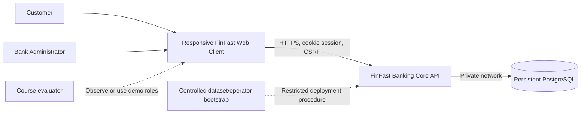
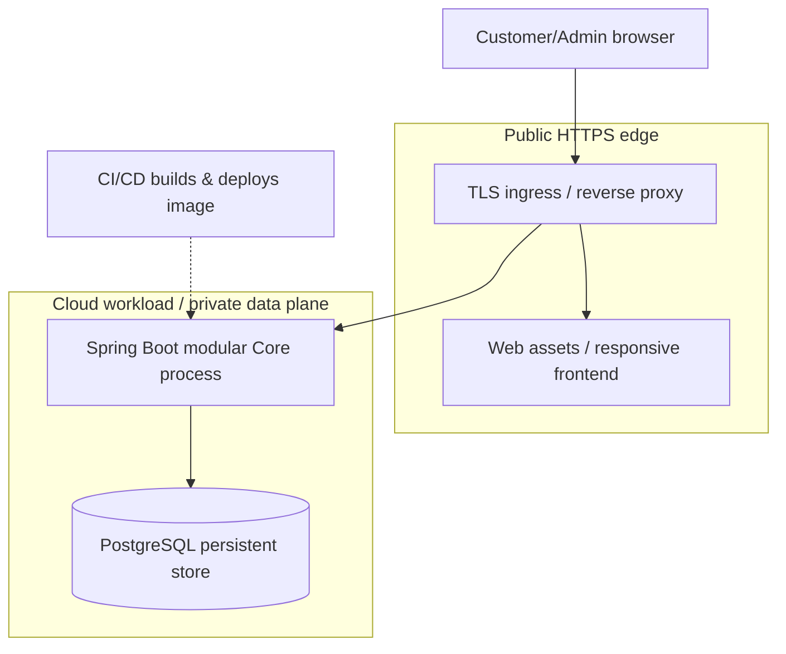
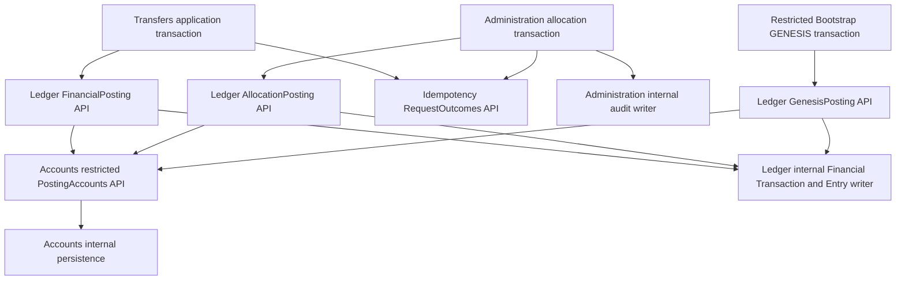
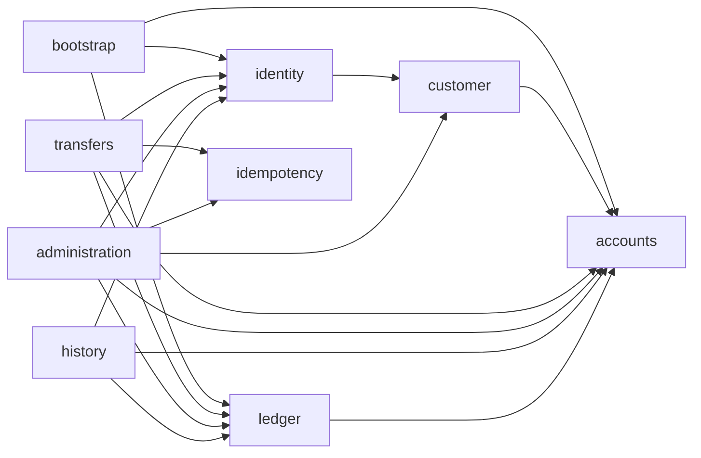

# 15 — System Context, Containers, Modules and Security Boundaries

The mandatory convention in §3 applies across the system. [Module boundaries](../architecture/boundaries.md) summarize ownership and allowed dependencies; [data design](16-domain-model-and-data-design.md) retains detailed financial/transaction protocols; [API guidance and OpenAPI](17-api-contracts.md) route to the frozen external interface. The [decision register](../6-governance/25-design-decision-register.md) records authority and historical decisions separately from these engineering rules. Implementation evidence and release acceptance remain separate.

Java 21, Spring Boot 4.1.1, Maven Wrapper and PostgreSQL 16 with Flyway form one deployable modular monolith. Deployment resources remain subject to EV-001/002; session/CSRF/BCrypt design selections require actual security verification.

> **Routing:** The concise target map and module ownership now live in [architecture overview](../architecture/overview.md) and [module boundaries](../architecture/boundaries.md). This file retains detailed approved Java package, adapter, and enforcement conventions.

The Modular Monolith sets deployment and logical module boundaries. DDD gives each module ownership of its domain concepts and invariants. Pragmatic Hexagonal Architecture keeps business logic separate from HTTP and persistence adapters without requiring an interface for every class. One six-person team can work within these boundaries while financial operations still share one database transaction. No mandatory microservices, Kafka, Kubernetes, Redis, event sourcing, distributed transactions or separate module databases are introduced. Provider and infrastructure sizing await EV-001/002.

## 1. Context



**Boundaries:** browsers are untrusted; User ≠ Customer ≠ Account. CORE is the financial source of truth and enforces authorization on every read/mutation. Database connections are not exposed publicly. Admin bootstrap and GENESIS are controlled deployment/setup procedures, **not application features**.

## 2. Container view (C4-style, indicative)



- One deployable Core process, one logical PostgreSQL financial database. Hosting can use a managed container runtime, VM with Docker, or other provider subject to EV-001/002.
- Frontend can be static-hosted or bundled/served through Core; both are a delivery design choice. Distinguish physical deployment from domain modules.
- Health/readiness endpoints reveal no financial data. All secrets from protected configuration/secrets store, never repository or client bundle.

## 3. Module ownership and the controlled posting path

The [module boundaries](../architecture/boundaries.md) define approved capabilities and ownership. Accounts owns balances/statuses; Ledger coordinates postings and immutable facts. Transfers/Administration own their application transactions, including final outcomes and required audits. Public contracts, concrete implementations, provider wiring, and verified integration are separate evidence levels.

| Module | Owns | Contract / permitted consumers and provider responsibilities |
|---|---|---|
| `identity` | User credentials, role policy, server sessions; registration orchestration | Authentication/authorization context for protected use cases; protected Admin provisioning for Bootstrap |
| `customer` | Customer profile and User linkage | Registration provisioning for Identity; limited customer metadata for Administration; calls Accounts to open one zero-balance Customer Account |
| `accounts` | Account identity, type, status, materialized balance and balance/status invariants | `AccountQueries` for authorized readers; `AccountProvisioning` for Customer; separate `TreasuryProvisioning` for Bootstrap; `AccountStatusCommands` for Administration; restricted `PostingAccounts` for Ledger only |
| `transfers` | Customer transfer intent validation and orchestration | Customer transfer application entry; calls Ledger's `FinancialPosting` and Idempotency's `RequestOutcomes` |
| `ledger` | Financial Transactions, signed entries, immutable references, posting semantics, reconciliation and dataset posting order | `FinancialPosting` for Transfers, separate `AllocationPosting` for Administration, `GenesisPosting` for Bootstrap; History-only `LedgerQueries`; Administration financial inspection through `AdminFinancialTransactionQueries` |
| `idempotency` | Durable full scoped identity, canonical intent, final result, coordination and recovery | `RequestOutcomes` for Transfers/Administration; authorized lookup accepts server-established initiator context, never an arbitrary user ID from the client |
| `administration` | Treasury allocation, account status orchestration, required Admin Audit Events | Authorized Admin use cases; calls Ledger for funding and Accounts for status; owns audit persistence inside the same transaction |
| `history` | Read-only history and receipt projections | Authorized reads through Accounts/Ledger APIs; no financial or account mutation |
| `bootstrap` | Restricted Admin provisioning and controlled GENESIS procedure | Operator/setup entry, no public HTTP API; calls Identity, Accounts and Ledger initialization APIs |

### 3.1 One financial posting path (ARC-01)



BK-003 represents ordinary posting as separate `FinancialPosting` transfer and
`AllocationPosting` allocation interfaces; this split and TD-015 ownership are
approved. Their provider implementations must validate typed
authorized intent and Account roles, request protected paired changes through
`PostingAccounts`, then create a reference and two equal-and-opposite entries.
Accounts rechecks current ACTIVE status, ownership, funds and safe bounds before
either change. `PostingResult.Pending` is inside the existing transaction, not
commit evidence; the outer use case must join final outcome and required
allocation audit before commit. See [16 §5](16-domain-model-and-data-design.md#5-transaction-boundaries-and-outcomes-arc-02).

Transfers may invoke only the internal-transfer operation; Administration only demo allocation. Enforce these method-level restrictions as well as package access, and verify CUSTOMER-to-CUSTOMER versus TREASURY-to-CUSTOMER account types within the posting operation. Callers cannot supply an arbitrary debit/credit delta or bypass owner/role authorization. Neither controller nor Transfers/Administration may import Accounts/Ledger repositories, write balance columns, or create ledger facts directly.

`PostingAccounts` is not a generic public balance setter. Its restricted operations apply a validated pair under locks, or initialize Treasury within the special GENESIS boundary. GENESIS is the sole one-entry positive initialization, guarded by dataset uniqueness and stable reference; it is not an ordinary zero-sum posting. Opening a Customer Account sets zero without creating money. Initialization APIs are unavailable to normal financial callers. Accounts owns their state validation, Ledger owns GENESIS facts, and Bootstrap encloses setup in one transaction.

### 3.2 Allowed module dependencies (ARC-06)

An arrow means an allowed Java dependency on the target's explicit public API, never its internals. This is the **TD-016 acyclic allowlist: nine modules, 18 edges**; not every use case needs every arrow. Additional public capabilities/directions require prior Tech Lead approval.



Identity registration orchestrates Customer provisioning and the zero-balance Account through Customer's API in one transaction. Accounts has no return dependency on Customer or Identity: ownership identifiers are values, not imported entities. Ledger does not depend on Transfers, Administration or Idempotency; its posting result lets those callers finish their own outcome/audit work. History authorizes reads before using projections; it cannot join private tables through another module's repository. Idempotency is independent of business modules and consumes a trusted initiator/operation context; current authorization is still checked before every lookup/replay. Audit writing stays within Administration, avoiding a Ledger → Administration cycle.

### 3.3 Java project and module structure (DOC-02)

This is the mandatory engineering convention for every existing and future FinFast feature across all nine business modules and implementation phases. Modular Monolith boundaries, DDD responsibilities and Hexagonal dependency directions apply together. A directory diagram assigns responsibilities; it does not require empty packages or imply that every provider is implemented. Check responsibilities, contract ownership and transaction boundaries before writing code.

One Spring Boot application is organized by domain first:

```text
com.finfast/
├── FinfastApplication.java
├── common/
├── identity/
├── customer/
├── accounts/
├── transfers/
├── ledger/
├── idempotency/
├── administration/
├── history/
└── bootstrap/
```

Each business module uses the following responsibility-based structure. Create only packages containing real implementation; no placeholder classes, empty package scaffolding or generic use-case frameworks.

```text
module/
├── api/
│   └── ApprovedPublicModuleCapability.java
└── internal/
    ├── domain/
    │   ├── entity/
    │   ├── valueobject/
    │   ├── service/
    │   └── exception/
    ├── application/
    │   ├── dto/
    │   ├── port/
    │   │   ├── inbound/
    │   │   └── outbound/
    │   ├── usecase/
    │   └── service/
    ├── adapter/
    │   ├── inbound/
    │   │   └── http/
    │   └── outbound/
    │       └── persistence/
    └── config/
```

#### Module boundaries and public APIs

Cross-module dependencies must follow both the nine-module/eighteen-edge graph in §3.2 and the narrower capability permissions in the [module contracts](module-contracts-and-boundaries.md). Calls are in process; modules share one logical PostgreSQL database, without cross-module HTTP/gRPC or distributed transactions. Sharing a database/transaction never permits access to another module's internal repositories, entities or tables.

`api` owns only approved public capabilities and immutable boundary values. Public contracts must remain framework-free and must not reference their own `internal` types. Public Java visibility does not authorize cross-module use. Internal ports are private to their owning module; adding one grants no public capability or dependency edge. `common` contains suitable pure shared contracts and technical infrastructure, cannot depend on business modules and must not accumulate business workflows or generic repositories.

#### Domain responsibilities

`internal/domain` owns entities, value objects, domain services, genuinely necessary domain exceptions, business validation and local invariant protection. Domain code must not depend on application, adapters, configuration, Spring, HTTP/Servlet, JDBC, JPA or persistence/serialization frameworks. It must not execute SQL/HTTP or orchestrate infrastructure. Foreign module internals remain forbidden. Domain objects should be immutable where appropriate; financial facts must preserve their approved immutability.

Put behavior on its owning entity/value when suitable. Introduce a domain service only for actual domain behavior that does not belong on one object. Do not invent a service or exception to fill a folder. Expected business rejections, invariant violations and technical failures retain the distinct meanings defined by module contracts.

#### Application contracts and orchestration

| Package | Mandatory responsibility |
|---|---|
| `application/port/inbound` | Explicit interfaces for feature-facing use-case entries. Contracts depend on application DTOs, domain/pure shared values or approved API values, never concrete use cases, helpers, outbound ports or infrastructure. |
| `application/usecase` | Concrete use-case implementations implement their inbound contract, orchestrate business operations and establish the approved transaction boundary. A small package-private error catalog local to one use case may stay alongside it. |
| `application/dto` | Immutable commands/results separate from concrete implementations; preserve ownership of existing approved public API values. DTOs must not depend on control classes, ports, adapters or configuration. |
| `application/port/outbound` | Interfaces expressing capabilities the application needs, such as module-local persistence. They must not depend on concrete adapters, use-case implementations/helpers, inbound ports, configuration or infrastructure frameworks. |
| `application/service` | Application-specific helpers/coordination needed by actual use cases, such as canonical input production. Helpers do not become alternative feature entry points or bypass domain invariants. |

An approved public module API can already serve as the inbound contract. Ledger's `FinancialPosting`, `AllocationPosting` and `GenesisPosting` implementations must not acquire duplicate internal inbound interfaces. A required use-case contract is intentional; it does not require an interface for every DTO, helper, enum, entity or value object. Ports must not point back to concrete implementations.

Application orchestration calls domain behavior, approved module APIs and outbound ports. It must not depend on HTTP, SQL/JDBC, concrete persistence adapters or configuration. Keep domain invariants in their owning module; do not duplicate Account eligibility/balance authority or financial posting construction in consumers. Commands and canonical intent preserve exact validated data according to their contracts; transport parsing does not establish financial eligibility.

#### Inbound adapters

`adapter/inbound` translates external interactions into application invocations. HTTP controllers under `adapter/inbound/http` bind/validate transport input, map errors/results to the frozen REST contract and invoke inbound interfaces through configured proxies. Controllers must remain thin, must not depend on concrete use-case/helper implementations and must not call outbound ports, repositories or persistence adapters. They must not manipulate domain objects to orchestrate business workflows, change balances, construct financial facts or own financial transactions.

Transport authentication/CSRF checks do not replace trusted authorization and resource checks at the application boundary. Never accept client-provided actor identity as authority. HTTP serialization must follow successful outer proxy completion; a Pending value or a method-body return cannot certify commit. Preserve all operation-specific result/error distinctions in [17](17-api-contracts.md).

#### Outbound adapters and persistence

`adapter/outbound` implements module-owned outbound ports or approved provider APIs. Persistence adapters under `adapter/outbound/persistence` own module-local SQL, mappings, repositories and approved locking/transaction guards. They depend inward on contracts and domain values, must not invoke use-case entries/inbound adapters, and must not expose persistence models through public APIs. No direct foreign-table SQL, generic balance setters or alternative financial mutation authority is permitted.

Adapters must propagate technical persistence failures. Required financial/audit writes join the existing transaction; adapters must not commit independently, swallow failed writes or turn technical failure into durable business rejection. Preserve Flyway migrations and immutable Ledger safeguards. Schema amendments follow their separate review process.

#### Configuration and constructor injection

`internal/config` is the composition boundary for Spring beans, adapters, resources and proxy configuration. Use constructor injection throughout module implementations; no field/setter dependency injection or service-locator shortcuts. Domain/application code must not depend on configuration. Do not manufacture production providers when collaborators are unavailable; test-scoped collaborators remain test-only. Create no new framework abstraction or dependency solely to satisfy the package diagram.

#### Transaction ownership and financial integrity

Concrete transactional entries retain Spring annotations; pure ports/public APIs have none. An externally invoked outer financial use case uses `Propagation.REQUIRED`, PostgreSQL `Isolation.READ_COMMITTED` and `rollbackFor = Exception.class`. Restricted mutation/coordination implementations require the caller's transaction, normally through concrete MANDATORY guards. Read/inspection entries retain their approved read-only/isolation contract, including GENESIS inspection; the financial write rule does not override those contracts.

Use actual Spring interception through the injected contract, without self-invocation bypass. All required effects share one PostgreSQL DataSource and transaction manager: balances, immutable paired Ledger facts, final idempotency outcome and required success audit commit together. No REQUIRES_NEW financial effects, manual/independent commits, asynchronous required writes or best-effort success audit. Preserve checked integral VND, finite supply, current locked Account eligibility, authorization-before-replay and exact scoped idempotency.

Technical failures must escape for rollback; a final business rejection is recorded only through the approved contract with no financial effects. Never treat PROCESSING/UNKNOWN or uncertain commit as final rejection. A caller must not expose success until the outer commit is confirmed. Pre-commit rollback safeguards and transaction-manager composition require real verification; rollback configuration cannot guarantee reversal after a commit has already succeeded. Recovery after uncertain commit uses the original idempotency scope/key. [Data design §5–7](16-domain-model-and-data-design.md#5-transaction-boundaries-and-outcomes-arc-02) defines the exact protocols.

### 3.4 Enforcing the boundaries (ARC-06)

**Architecture checks:** TEST-scope ArchUnit 1.5.1 with
`archunit-junit6`, matching Boot 4.1.1's managed Jupiter 6.0.3. These checks execute
through ordinary Maven tests; the §3.2 allowlist and current structural/capability
enforcement implement TD-016. Spring Modulith is not installed or
required by this baseline.

- Only the nine named business modules are cycle nodes. `common`, the root launch
  class and libraries are excluded. Business classes must reside under their
  module's `api` or `internal` packages. Internal code may use its own module's
  types; public API code must not depend on its own module's internal types;
  cross-module dependencies require both an approved edge and provider `api` access.
- [ProductionArchitectureTests](../../backend/src/test/java/com/finfast/architecture/ProductionArchitectureTests.java)
  scans compiled production code with test classes excluded. Rules cover package
  structure, public API isolation, cycles,
  domain/application isolation, controller JDBC/persistence access, clean business
  code and prohibition of shared-to-business dependencies. See the
  [implemented policy](../../backend/src/test/java/com/finfast/architecture/ModuleArchitectureRules.java).
- [RuleVerificationTests](../../backend/src/test/java/com/finfast/architecture/RuleVerificationTests.java)
  explicitly imports segregated test fixtures. Valid own/API/shared usage passes;
  foreign internals, reversed edges, cycles and layer/observability leaks are
  deliberately rejected. Production API selections now contain real contracts;
  internal-layer selections can remain empty. Fixture proof does not establish
  provider behavior, real module integration or financial acceptance.
- BK-003 adds pure-API and restricted-capability checks, preserving the same 18
  approved edges. Transfers cannot acquire allocation/GENESIS/Account mutation,
  and Treasury initialization calls/method references require Ledger's
  GenesisPosting implementation. Private helper delegation needs a concrete reviewed
  amendment rather than a blanket exception. Import/call checks
  cannot prove runtime authorization, transaction guards, atomicity or SQL ownership.
  Follow [module boundaries](../architecture/boundaries.md) and the real
  PostgreSQL/transaction gates in the [verification strategy](../verification/strategy.md).

- Reusable structural rules protect internal responsibility packages, inbound/outbound interfaces and port purity, DTO dependency direction, constructor injection and adapter dependency direction. Inbound adapters cannot own Spring transactions. Inbound adapters cannot depend on concrete application implementations, domain entities/services, outbound ports/adapters or configuration; pure value mapping does not authorize business orchestration. Outbound adapters cannot invoke application entries/inbound adapters. Domain/application checks exclude persistence frameworks as well as HTTP/JDBC. [ApplicationBoundaryVerificationTests](../../backend/src/test/java/com/finfast/architecture/ApplicationBoundaryVerificationTests.java) verifies current entry/DTO/transaction declarations and Ledger's existing public contracts. [HexagonalConventionVerificationTests](../../backend/src/test/java/com/finfast/architecture/HexagonalConventionVerificationTests.java) proves permitted structure and representative forbidden directions, including generic leaks and field/setter injection.
- Every implementation must pass the complete applicable rules, not just the rule exercised by an illustrative fixture. Feature-facing entry intent cannot be inferred reliably for every helper; verify each entry's interface relationship explicitly rather than requiring every application class to implement an interface. Dependency checks cannot establish SQL table ownership, detect every service-locator shortcut, prove runtime authorization, or confirm transaction-manager composition, commit/rollback and durability. Require code review and focused real PostgreSQL/proxy/failure/concurrency tests for those obligations. Mocks establish collaborator behavior only; they do not establish durable idempotency or acceptance.

**TD-016-AM-01..04** permit exactly Bootstrap to Ledger GENESIS inspection; Ledger to Accounts identity; Administration to Accounts Customer listing; Administration to Ledger financial inspection. All are existing graph directions: nine modules and 18 edges remain unchanged. AM-05 TreasuryInspection is not selected for V1 and has no source/permission entry. `LedgerQueries` remains History-only and all unrelated posting/provisioning restrictions remain intact. See [approved module capability summary](../architecture/boundaries.md#approved-posting-capabilities) and the [final decision](../6-governance/25-design-decision-register.md#final-v1-capability-decision--2026-10-23). Capability permission is separate from production provider wiring and feature acceptance.

## 4. Approved security design

- **Auth:** HTTPS only; server-side session storage with protected HttpOnly cookie, Secure under HTTPS and explicit SameSite (initial Lax where the actual frontend/Core topology permits); renew session ID after authentication, use explicit expiry and logout invalidation. `SameSite` alone is insufficient CSRF defense.
- **CSRF:** Spring Security CSRF token through the existing `/api/v1/auth/csrf` contract and its defined header for cookie-authenticated mutations, along with Origin/Referer checking where appropriate. No state-changing GET endpoint.
- **Password:** standard Spring Security BCrypt, initial configurable strength 12 (benchmark required); never log plaintext/password hashes; lockout/rate-limit rules subject to security review, not a new banking actor.
- **Authorization:** endpoints verify role and server-derived ownership before key lookup, receipt/history read and treasury access. Give safe indistinguishable unavailable-resource errors for unrelated Customer financial resources.
- **Audit:** required success Audit Events written in PostgreSQL transaction with state change. Separate best-effort security logs should record rejected attempts where appropriate without becoming financial postings; secrets and credentials never logged.
- **Least privilege:** dedicated runtime DB role with separate migration privileges where deployment supports it (current owner-role limitations must be recorded); no UPDATE/DELETE capability against immutable financial facts via application APIs. HTTPS certificates, DB credentials, and session secret/key never committed.
- **Operations:** bounded input sizes, page limits, structured request/trace IDs without sensitive payloads; metrics include transaction duration/rejected/unknown counts, not raw account credentials.

## 5. Deployment and failure domains

| Failure | Required behavior |
|---|---|
| Frontend refresh or lost HTTP response | Server still owns committed state; same-key recovery returns original final outcome |
| Core crash before DB commit | No partial financial data; rerun original key after restart |
| Core crash after DB commit | Persisted result/ledger remains; original key replayable |
| Database unavailable | Fail safely; no false `COMPLETED`; readiness fails; restore before retry |
| Admin audit write fails inside financial/status transaction | Entire affected operation rolls back; no unaudited success |
| TLS/session lost | Protected operations denied until authorized login; funds unchanged |

## 6. Operational and architectural evidence

- Tests: concurrency, failure injection, restart, reconciliation, session expiry/logout and customer/admin E2E.
- Deployment: immutable image digest, schema migration/version, DB persistence configuration, TLS ingress, restart logs, environment/revision metadata.
- Follow-up: compare against rubric EV-001 and resources EV-002; no claims of autoscaling or HA until directly demonstrated.

## 7. Architectural trade-offs

One modular monolith keeps the financial transaction boundary local for one small team. V1 has no independent module scaling requirement. Ownership, capability restrictions and selected financial protocols remain mandatory; future decomposition requires a separately reviewed architecture change. The [decision register](../6-governance/25-design-decision-register.md) retains their authority and history. Optional notifications are a P1 extension and never block financial commit.
