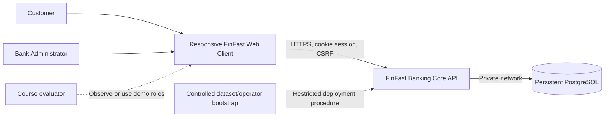
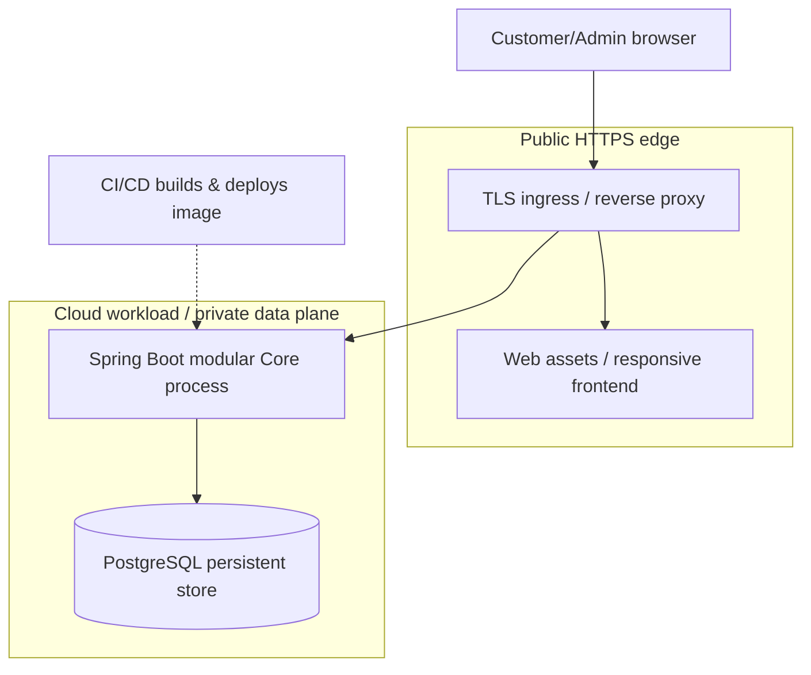

# 15 — System Context, Containers, Modules and Security Boundaries

> **PROPOSED technical architecture** consistent with approved direction A-013 / DEC-006: Java/Spring Boot, PostgreSQL, channel-independent **Modular Monolith**. No microservices, Kafka, Kubernetes, Redis, or cloud provider are mandatory in V1. Provider and infrastructure sizing await EV-001/002. This is a deployable blueprint, not evidence of deployment.

## 1. Context

**Boundaries:** browsers are untrusted; User ≠ Customer ≠ Account. CORE is the financial source of truth and enforces authorization on every read/mutation. Database connections are not exposed publicly. Admin bootstrap and GENESIS are controlled deployment/setup procedures, **not application features**. The external Fineract repository is research-only and never a runtime dependency.

## 2. Container view (C4-style, indicative)

- One deployable Core process, one logical PostgreSQL financial database. Hosting can use a managed container runtime, VM with Docker, or other provider subject to EV-001/002.
- Frontend can be static-hosted or bundled/served through Core; both are a delivery design choice. Distinguish physical deployment from domain modules.
- Health/readiness endpoints reveal no financial data. All secrets from protected configuration/secrets store, never repository or client bundle.

## 3. Module map (logical boundaries, not independent network services)

| Module | Owns | Allowed calls / constraints |
|---|---|---|
| `identity` | User credentials, secure sessions, role policy | No direct financial balance edits |
| `customer` | Customer identity/profile linkage | One account per Customer enforced within registration consistency boundary |
| `accounts` | Account number/status, read model, balance invariants | Financial balance mutation only through controlled core financial transaction operations |
| `transfers` | Customer transfer orchestration, intent validation | Uses financial posting boundary; no independent debit/credit commit |
| `ledger` | Financial Transactions, signed entries, immutable references, reconciliation | One atomic consistency boundary with Account balance effects |
| `idempotency` | Initiator/operation/key intent ownership and durable final outcome | Final outcome committed with financial effects/rejection; replay after authorization |
| `administration` | Treasury funding, reasoned status changes, required success audits | Funding/audit and freeze/audit commit atomically |
| `history` | Read-only committed movement/receipt projections | Only permitted Customer participants; stable pagination |
| `bootstrap` | Protected GENESIS and Admin provisioning procedures | Not public HTTP endpoints; one-time initial supply |

Suggested dependency rule: interfaces expose business operations without importing another module’s repository/entity classes. Cross-module DB participation is allowed **inside** the same Core transaction where financial invariants require it; separate HTTP calls are not.

## 4. Security design direction (must be reviewed before implementation)

- **Auth:** HTTPS only; server-side session storage with protected `HttpOnly; Secure; SameSite=Lax` cookie; renew session ID after authentication, use explicit expiry and logout invalidation. `SameSite` alone is insufficient CSRF defense.
- **CSRF:** Spring Security CSRF token (e.g. same-origin token header obtained through a safe endpoint) for cookie-authenticated mutations, along with Origin/Referer checking where appropriate. No state-changing GET endpoint.
- **Password:** adaptive hashing (propose Argon2id or a suitably configured BCrypt); never log plaintext/password hashes; lockout/rate-limit rules subject to security review, not a new banking actor.
- **Authorization:** endpoints verify role and server-derived ownership before key lookup, receipt/history read and treasury access. Give safe indistinguishable unavailable-resource errors for unrelated Customer financial resources.
- **Audit:** required success Audit Events written in PostgreSQL transaction with state change. Separate best-effort security logs should record rejected attempts where appropriate without becoming financial postings; secrets and credentials never logged.
- **Least privilege:** dedicated runtime DB role; migration privileges separate; no UPDATE/DELETE capability against immutable financial facts via application APIs. HTTPS certificates, DB credentials, and session secret/key never committed.
- **Operations:** bounded input sizes, page limits, structured request/trace IDs without sensitive payloads; metrics include transaction duration/rejected/unknown counts, not raw account credentials.

## 5. Deployment and failure domains

| Failure | Required behavior |
|---|---|
| Frontend refresh or lost HTTP response | Server still owns committed state; same-key recovery returns original final outcome |
| Core crash before DB commit | No partial financial data; rerun original key after restart |
| Core crash after DB commit | Persisted result/ledger remains; original key replayable |
| Database unavailable | Fail safely; no false `COMPLETED`; readiness fails; restore before retry |
| Admin audit write fails inside financial/status transaction | Entire affected operation rolls back; no unaudited success |
| TLS/session lost | Protected operations denied until authorized login; funds unchanged |

## 6. Operational and architectural evidence

- Tests: concurrency, failure injection, restart, reconciliation, session expiry/logout and customer/admin E2E.
- Deployment: immutable image digest, schema migration/version, DB persistence configuration, TLS ingress, restart logs, environment/revision metadata.
- Follow-up: compare against rubric EV-001 and resources EV-002; no claims of autoscaling or HA until directly demonstrated.

## 7. Architectural trade-offs

Why monolith initially? Strong financial transaction boundary, one small team, no independent scaling or ownership requirement across Accounts/Transfer/Ledger in V1. This is an **approved initial direction**, not a commitment against later decomposition. Formal rationale: [ADR-001](19-adr-service-boundaries.md). Optional notifications are a P1 extension and never block financial commit.
