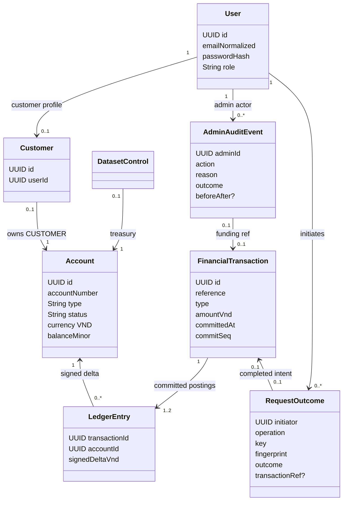
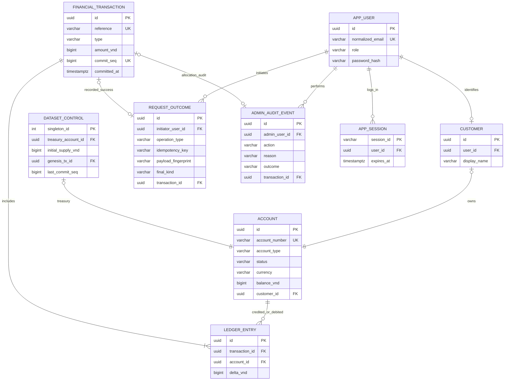
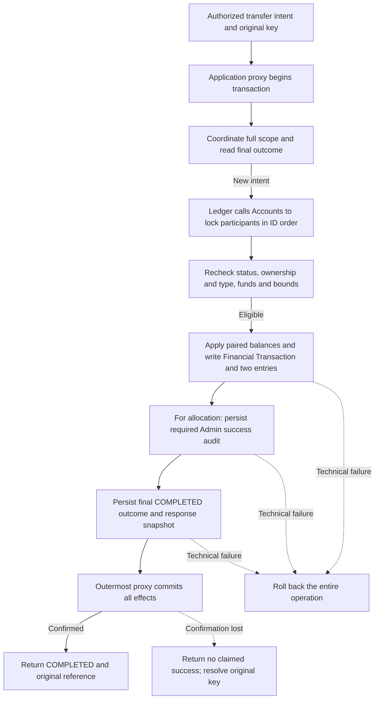
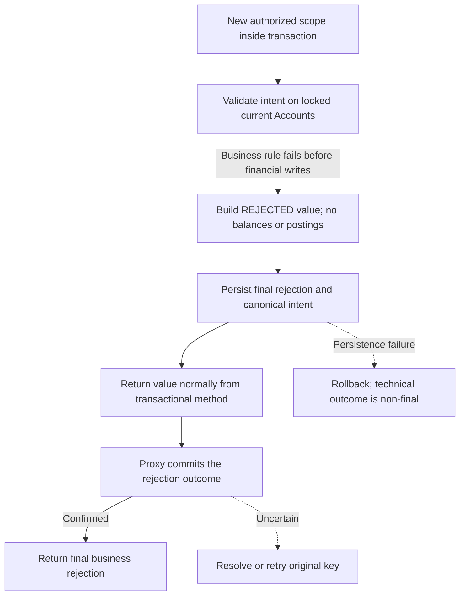

# 16 — Domain Model, ERD, PostgreSQL Data and Invariants

> **APPROVED — DESIGN, evidence pending (2026-10-22):** The later [V1 freeze](../6-governance/25-design-decision-register.md#v1-engineering-design-freeze--2026-10-22) explicitly selects TD-001..014; BK-003/TD-015/016 are already merged. This is implementation guidance, not financial runtime verification. Actual [V1/V2 migrations](../../backend/src/main/resources/db/migration/README.md) are schema authority; conceptual diagrams below do not create additional tables/constraints. Approved business meaning and public Java signatures are preserved. No full General Ledger is implied.

## 1. Domain relationships

`FinancialTransaction` has exactly **two** linked entries for `INTERNAL_TRANSFER`/`DEMO_ALLOCATION` and exactly **one positive treasury entry** for `GENESIS`. A final business rejection has a `RequestOutcome` but **zero Financial Transactions**. This is cardinality based on transaction type; it is not one optional entry for rejected requests.

## 2. Logical ERD

Note: Mermaid diagrams are conceptual. The checked-in V1/V2 SQL and migration guide are authoritative, including immediate FKs and absence of session tables/extra singleton-link uniqueness indexes. `APP_SESSION` depicts a session concept, not an approved ninth banking table. Use framework server sessions under TD-006; no session table or durable-session mechanism is added by this design freeze. `DATASET_CONTROL` links Treasury/GENESIS atomically during protected setup.

## 3. Existing schema constraints and application obligations

| Table / concept | Columns / uniqueness (illustrative) | Database guarantees and application obligations |
|---|---|---|
| `app_user` | UUID PK; `email_normalized` UNIQUE NOT NULL; `role` CUSTOMER/ADMIN; password hash | Stored email uniqueness and allowed role values; application normalizes email and prevents Admin self-registration |
| `customer` | UUID PK; UNIQUE `user_id` FK; display_name | At most one profile per User; application creates the required Customer profile during registration |
| `account` | UUID PK; UNIQUE `account_number`; `customer_id` nullable FK with UNIQUE; `account_type`; `status`; `currency='VND'`; `balance_vnd BIGINT CHECK >=0` | CUSTOMER has exactly one owner; TREASURY is system-owned; no negative balance |
| `dataset_control` | singleton PK (=1); Treasury/GENESIS FKs; immutable initial supply; `last_commit_seq` | One supply and one Treasury linkage; globally serialized posting order (TD-004 design; posting implementation pending) |
| `financial_transaction` | UUID PK; UNIQUE immutable `reference`; UNIQUE `commit_seq`; type enum; amount BIGINT CHECK >0; `committed_at` | Financial facts only when committed; exact ordinary/GENESIS cardinality checked in posting layer and tests |
| `ledger_entry` | UUID PK; FK tx/account; `delta_vnd BIGINT CHECK <>0`; UNIQUE `(transaction_id, account_id)` | Unique transaction/Account pair and nonzero delta; application enforces paired entries or the single positive GENESIS entry |
| `request_outcome` | UNIQUE (`initiator_user_id`,`operation_type`,`idempotency_key`) with all three NOT NULL; canonicalization version, canonical intent, fingerprint, final kind and response snapshot; nullable tx FK; rejection code | Unique full scope and valid final-row shape; application enforces lifetime retention, immutable outcomes and technical/business separation |
| `admin_audit_event` | UUID PK; admin FK; action; target; reason; timestamp; outcome; tx FK or state-before/after | FKs and required audit-row shapes; application persists the complete audit atomically with funding/status change |
| Session concept (no `app_session` table in V1/V2) | Framework-managed session ID, authenticated principal, expiry/revocation | Application/framework must enforce server-side termination; not a migration guarantee |

**Enforcement notes:** Existing Flyway V1 constraints and V2
append-only triggers enforce row-level structural guarantees
and prohibit mutation of persisted financial facts.

The application layer must enforce transaction cardinality,
exact signed-entry invariants, locked Account eligibility
and atomic persistence.

Cross-row balance and supply reconciliation must be verified
using consistent committed snapshots.

Additional deferred cardinality triggers are not part of
the approved V1 design. Any future schema extension requires
a separate reviewed migration.

## 4. Monetary representation (selected TD-001)

- VND as **signed 64-bit integer** `BIGINT` / Java `long` (no decimal/floating-point). Positive `amountVnd` within 1..9,223,372,036,854,775,807, with safe signed negative delta. Use `Math.addExact` / `Math.subtractExact` (or checked `BigInteger` intermediates) before every result; reject invalid/out-of-range values.
- JSON amount should use a **decimal string containing digits only** (for example `"200000"`) to preserve precision for JavaScript browsers; API domain name `amountVnd`. Browser inputs parse whole-VND decimal strings, never `Number` for monetary arithmetic. This is the TD-001/008 selected transport and existing OpenAPI direction; it preserves integer-valued VND domain semantics.
- No artificial commercial transfer cap; available balance and representable range still apply. Default GENESIS 100,000,000 VND can be replaced by a valid amount only before creation.

## 5. Transaction boundaries and outcomes (ARC-02)

**APPROVED TD-015 responsibilities; concrete realization selected by the later TD-002/003/011 freeze.** Ownership and API allowlists are defined in [15 §3](15-system-architecture.md#3-module-ownership-and-the-controlled-posting-path). Transfers owns the transfer outer transaction; Administration owns allocation and required audit; Ledger owns controlled paired posting/facts/reconciliation; Accounts owns balance/status invariants; Idempotency owns scoped intent/outcomes. Every financial entry uses one PostgreSQL database and transaction manager; all required effects commit together. No cross-module network calls, isolated debit/credit commits or asynchronous financial commits are allowed.

| Application entry point (illustrative name) | Transaction contents | Commit boundary |
|---|---|---|
| Transfers `ExecuteTransfer` | Scope coordination; final-result replay/conflict or locked validation; Ledger posting through Accounts; durable final outcome | Outermost application transaction, before HTTP serializes a final result |
| Administration `AllocateDemoFunds` | Same controlled posting path, with Treasury and recipient locks; required success audit and final outcome | Same transaction as balances, Financial Transaction and both Ledger Entries |
| Administration `ChangeAccountStatus` | Lock Account; validate reason/status; status change and complete required audit | One transaction; failure of audit persistence rolls back status |
| Identity `RegisterCustomer` | User, Customer and exactly one zero-balance Account through module APIs | One registration transaction; no partial provisioning |
| Bootstrap `InitializeDataset` | Single Treasury, finite supply, special GENESIS entry/reference and dataset control | One protected initialization transaction; existing dataset is verified, never reseeded on restart |

### 5.1 Spring transaction contract

BK-003 supplies approved pure source interfaces/DTOs only. Exact signatures, authorized
consumers and value semantics live in the [canonical module guide](module-contracts-and-boundaries.md#transactions-and-posting-permissions).
Transfers consumes `FinancialPosting`, Administration `AllocationPosting`,
Bootstrap `GenesisPosting`; only Ledger consumes guarded `PostingAccounts`.
No transaction annotation/proxy/manager or posting implementation is added.
The realization below is approved implementation guidance; execution evidence remains required:
compile-time Pending/Completion values do not prove that a transaction committed.

Place `@Transactional` at the externally invoked application use-case entry, with **REQUIRED** propagation, READ COMMITTED and explicit technical-failure rollback policy. Collaborators join that transaction through the same transaction manager/data source. The restricted Ledger/Accounts mutation entry must require an existing transaction (normally concrete `MANDATORY` as a guard); it must never silently commit a standalone debit. Domain objects need no transaction annotations. Do not use `REQUIRES_NEW` for ledger, balance, outcome or required Admin success audit: it would permit independently committed pieces. See [Spring propagation semantics](https://docs.spring.io/spring-framework/reference/data-access/transaction/declarative/tx-propagation.html).

In proxy-based Spring transactions, the controller calls the application bean through its proxy. Self-invocation does not create the intended intercepted boundary. The target method returns a pending result; the proxy commits before returning control to the caller. Thus returning from the method body or flushing JPA is **not** confirmation of commit. Keep HTTP response creation after the proxy returns successfully; test the actual proxy wiring rather than invoking the class directly. See [Spring transaction interception](https://docs.spring.io/spring-framework/reference/data-access/transaction/declarative/annotations.html).

Technical/persistence failures must escape the transactional boundary with rollback semantics. Spring's default rollback covers unchecked exceptions/errors, not every checked exception; configure explicit rollback for checked technical failures or translate them consistently. Never catch a failed SQL write inside the transaction and continue as though it succeeded, and never return success from a rollback-only transaction. A bounded retry runs **outside** the transactional proxy and invokes a fresh transaction. See [Spring rollback rules](https://docs.spring.io/spring-framework/reference/data-access/transaction/declarative/rolling-back.html).

The durable-commit premise also needs explicit PostgreSQL configuration: retain `fsync=on`, `full_page_writes=on` and synchronous local WAL flush (`synchronous_commit=on` for this selected single-database design), with persistent storage for financial facts, outcomes and required audits. Do not disable durability to make a benchmark pass. Record and verify the actual configuration during restart/crash tests; confirming a transaction on a configuration that can lose acknowledged commits does not satisfy the promised final outcome. This is an implementation safeguard for existing durability requirements, not a production HA commitment. See [PostgreSQL WAL and commit settings](https://www.postgresql.org/docs/16/runtime-config-wal.html).

### Committed inspection boundary — TD-016-AM-01

**APPROVED — V1 by Tiến, 2026-10-23.** `JdbcGenesisDatasetInspection` starts/joins a read-only REPEATABLE READ transaction through its concrete Spring proxy and checks the actual bound resource, read-only mode, isolation and disabled autocommit. SELECTs access Ledger-owned tables only and reconstruct existing validated facts. Unproxied calls without a compatible transaction, write/aborted setup transactions and incompatible resources/isolation fail. No REQUIRES_NEW, financial commit, Account SQL, automatic Bean or write is added.

Empty requires no dataset/financial/entry facts. A result verifies GENESIS position 1, finite timestamp/currency/reference, one matching positive Treasury entry, supply/linkage and contiguous committed position/counter agreement. Incomplete/orphan/inconsistent Ledger state fails technically. Ordinary entry correctness and Account balances are not fully reconciled here.

After failed setup, Bootstrap unwinds the transaction before a fresh inspection; it may inspect a committed winner only after loser rollback. Existing V1/V2 guards protect singleton Treasury, type/system ownership/ACTIVE/VND/nonnegative balance, immutable Account identity, dataset FKs/insertion linkage and immutable initial supply. AM-05 TreasuryInspection is NOT SELECTED — V1: no additional Accounts read is required for this scoped initialization evidence. Real Accounts provisioning, outer transaction integration, protected Admin setup, concurrent recovery and restart tests remain necessary. Never compare current Treasury balance directly to initial supply after allocations, or treat valid Treasury/GENESIS existence as full financial reconciliation. Full balance/supply/ordinary-entry reconciliation and operator acceptance remain separate; no production reconciliation API is introduced.

### Committed Admin financial inspection — TD-016-AM-04

**IMPLEMENTED — Ledger contribution, 2026-10-24; real-provider integration pending.** [AdminFinancialTransactionQueryService](../../backend/src/main/java/com/finfast/ledger/internal/application/usecase/AdminFinancialTransactionQueryService.java) implements the existing public inbound contract without a duplicate inbound port. Its concrete Spring REQUIRED/read-only/REPEATABLE READ entry calls the Ledger-owned [CommittedFinancialTransactions](../../backend/src/main/java/com/finfast/ledger/internal/application/port/outbound/CommittedFinancialTransactions.java) outbound port and Accounts' approved `AccountIdentityQueries`. Administration remains responsible for ADMIN authorization before invocation.

[JdbcCommittedFinancialTransactions](../../backend/src/main/java/com/finfast/ledger/internal/adapter/outbound/persistence/JdbcCommittedFinancialTransactions.java) requires the caller's transaction and the actual bound, non-autocommit, read-only REPEATABLE READ connection. It reuses the established GENESIS inspection for empty-state, supply, linkage and contiguous position/counter checks, then reads every transaction and its complete entries in one joined query. SQL accesses only Ledger-owned tables. The shared `FinancialTransactionRows` reconstruction is also used by `JdbcFinancialTransactionRepository.findById`; unchanged domain factories enforce GENESIS/ordinary cardinality, distinct participants and exact signed magnitudes. The existing inspection guard moves into `LedgerJdbcTransaction` without weakening its checks; posting SQL/algorithms are unchanged.

Transactions are ordered by `commit_seq DESC`; entries by signed delta then entry UUID. Recorded time is preserved at its stored precision and is never ordering authority. Every original UUID/reference/type/amount is retained. GENESIS remains one positive initialization entry. Identity resolution caches each UUID only within the invocation, rejects missing/mismatched IDs, duplicate Account Numbers and incompatible CUSTOMER/TREASURY roles, and exposes only Account Numbers with signed deltas. Corrupt facts or SQL failures fail the complete listing; no skipping, invented identities, audit/outcome rows, mutation, retry or independent financial commit occurs.

The full-list contract has no paging or row cap: memory grows with transactions/entries and distinct participant identities. Ledger SELECT count is fixed rather than one query per transaction; AM-02's existing single-ID API requires one call per distinct Account. The complete fact set and projection coexist during mapping. Dataset size and latency require operational measurement; no performance acceptance is claimed.

Production composition is intentionally absent while Hải's real AM-02 provider is unavailable. Future Ledger `internal/config` wiring must inject both concrete implementations through transaction proxies and use the same DataSource/transaction manager for Ledger and Accounts identity reads, with no independent identity snapshot. [Isolated PostgreSQL evidence](../05-verification/22-test-strategy-and-acceptance.md#bk-018-ledger-am-04-verification--2026-10-24) uses a strictly test-scoped Accounts collaborator. Administration/BK-018 authorization/HTTP integration, real-provider snapshot verification and end-to-end acceptance remain pending; BK-010 Phase 6 and complete BK-018 are not completed by this provider.

### 5.2 Success and final rejection flows

Reject before applying either balance change. A final business rejection is an application result value, not an exception thrown through the transaction that would erase its stored outcome. All money/status/funds checks must finish before writes; a later technical failure or constraint surprise rolls back the operation instead of being recast as a final rejection after partial writes. Previously committed rejections are replayed without rechecking mutable eligibility.

| Situation | Persisted final outcome | Client-visible meaning |
|---|---|---|
| Confirmed financial commit | COMPLETED with immutable original reference/response | Success; one committed movement |
| Confirmed business rejection commit | REJECTED with stable reason/response; no transaction link | Final refusal; new business attempt needs a new key |
| Confirmed rollback/crash before commit | No new final record or financial effects | Technical failure; same key can safely recover/retry |
| Commit acknowledgement lost | May be COMPLETED/REJECTED, or absent | UNKNOWN to caller; consult the authoritative database through same-scope recovery |
| Duplicate still waiting | Original operation may be active | PROCESSING only with evidence of that intent; otherwise UNKNOWN; neither is a persisted final outcome |

The success audit, posting, balance changes and final outcome of allocation are indivisible. Freeze/unfreeze likewise cannot become effective without its required audit. Same-status requests return UNCHANGED without financial movement; optional attempted-operation audit is separate from a successful state-change audit. Security/operational rejection logs are not financial postings and must not determine the financial outcome.

## 6. Locking and isolation discipline (ARC-03)

**Selected TD-002: pessimistic PostgreSQL row locking at READ COMMITTED.** Every mutation path must follow this protocol:

1. Establish authorized initiator and operation, then acquire idempotency-scope coordination (§7). Resolve an existing final result before testing changeable balances/statuses.
2. Determine the complete participant set using immutable Account IDs. Sort UUIDs by unsigned lexicographic order of their 16 network-order bytes (equivalently compare most-significant then least-significant 64-bit parts with unsigned comparison). Issue an individual `SELECT ... FOR UPDATE` per ID sequentially in that order, irrespective of debit/credit direction. Java UUID default signed comparison is not the selected comparator; `ORDER BY` alone is not proof of lock acquisition order. Do not acquire Accounts incrementally in source-first order. PostgreSQL's [UUID comparator uses a 16-byte comparison](https://github.com/postgres/postgres/blob/REL_16_STABLE/src/backend/utils/adt/uuid.c); prove Java/SQL equivalence with boundary vectors.
3. Reload and check **both locked current rows**: type, ownership where applicable, VND, ACTIVE, available funds and safe resulting balances. A pre-lock display balance/status is never authority to spend. Allocation includes Treasury and the Customer Account in the same sorted set. No caller supplies an arbitrary treasury source.
4. For eligible postings, acquire/update the singleton `dataset_control` row **after** all participant locks, assign `commit_seq`, and finish writes plus required audit/outcome. Hold all locks through commit/rollback. Keep this final section short; no HTTP, user interaction or external work inside it. Do not request additional Account/scope locks after acquiring the global row.
5. Freeze/unfreeze acquires the same target Account row lock and commits status+audit together. It does not need a financial sequence or funding key. If freeze wins, waiting transfer/funding rechecks FROZEN and rejects; if movement wins, it may commit before freeze. Failed freeze audit rolls back the freeze. Unfreeze follows the same ordering. This preserves the approved effective-state rules without retroactively reversing a movement.

Opposite-direction transfers lock the same pair in the same order. Competing debits serialize on the source; a later transaction sees the committed remainder and rejects if funds are insufficient. Concurrent allocations serialize at Treasury, even with distinct target Customers. These properties rely on transactions being short and all mutation paths obeying the protocol; no fairness or unlimited-throughput guarantee follows.

PostgreSQL holds row locks until transaction end, and a waiter can lock the newer row after its predecessor finishes. Transaction-scoped advisory locks also end with the transaction. These features support the selected protocol; they do not make authorization automatic. See [PostgreSQL explicit locking](https://www.postgresql.org/docs/16/explicit-locking.html).

At READ COMMITTED, use a **new statement after acquiring coordination** to read a final outcome; do not combine a waiting lock function and outcome lookup into one statement whose snapshot predates the wait. Locked Account rows protect local state checks; global supply is preserved by paired atomic movements and controlled GENESIS, not by a concurrent unlocked sum check. Uniqueness constraints protect absent-row races (Account ownership, full key, singleton GENESIS). READ COMMITTED is not sufficient for arbitrary new cross-row predicates; any future invariant requires its own analysis. See [PostgreSQL isolation behavior](https://www.postgresql.org/docs/16/transaction-iso.html).

**Constraint backstops:** NOT NULL full scope fields; unique full scoped key, Account number and Customer ownership; valid account type/owner combinations; nonnegative bounded balances; positive transaction amounts; immutable unique reference/sequence; entry FK and `(transaction_id,account_id)` uniqueness; singleton dataset and GENESIS linkage. Cross-row entry counts/zero sum still require posting validation and reconciliation; a unique constraint alone does not enforce them. Exactly-one initialization must also withstand concurrent setup when no control row yet exists, using a unique singleton plus one atomic protected setup transaction. A losing initializer rolls back all of its own rows and then verifies the committed dataset. Restart/configuration mismatch must never reseed.

**Deadlocks/timeouts:** consistent Account ordering reduces deadlocks, but foreign keys, unique indexes and other locks can still produce them. Treat deadlock (`40P01`), serialization failure (`40001`, if encountered), and lock-unavailable/timeout (`55P03`) as technical failures. Roll back and release the transaction; never continue using an aborted connection transaction. A cancellation/connection failure requires diagnosis rather than blanket classification as a business rejection. Retry the entire original intent in a fresh transaction with the **same key**, bounded attempts, backoff/jitter and a request deadline. Approved initial configurable defaults are 3 total attempts (including first), nominal backoffs 25 ms then 75 ms with bounded jitter, all within an initial 2-second internal operation deadline. Bound each lock wait to the remaining deadline; retry outside the proxy with a fresh transaction, preserving scope/intent. Resolve an ambiguous commit through the original scope before executing again. These are defaults for measurement/tuning, not a p95 or completion guarantee. Exhaustion remains non-final technical uncertainty under the existing HTTP contract, and must be counted as a benchmark failure where applicable. Do not blindly retry deterministic constraints or corrupt data. On an outcome-key unique violation, roll back the entire attempted posting, then coordinate/reread the winner; never suppress the error and commit partial effects.

Actual deadlock, timeout, freeze and opposite-direction schedules must run against real PostgreSQL, as specified in [22](../05-verification/22-test-strategy-and-acceptance.md). No such execution is claimed here.

## 7. Idempotency and recovery (ARC-04)

### 7.1 Durable identity and canonical intent

The full identity is `(initiator_user_id, operation_type, idempotency_key)`, with a durable **NOT NULL + UNIQUE** constraint across all three fields. The server derives initiator and operation; the key is opaque and case-sensitive, with no silent trimming or automatic reuse. Final records survive for the entire dataset lifetime. The current schema/header and approved Java `Key` require 1–200 characters without truncation; broader input-size hardening remains separate review work.

Selected canonicalization version `v1`:

- Parse a structurally recognizable request after authentication/CSRF/role/resource checks. Use a fixed, documented field order and deterministic UTF-8 JSON encoding, independent of input JSON property order/whitespace. Reject ambiguous duplicate JSON property names and input unsupported by the existing HTTP contract before accepting the intent; do not tighten that contract through this documentation change.
- Include trusted initiator and operation, source, exact destination Account number, currency VND, amount, and every meaningful note/reason field. Transfer source is the trusted Account ID; allocation source is the fixed `TREASURY` marker in this singleton dataset, because Administration has no approved Treasury-identity query. Ledger selects/verifies actual Treasury; do not invent a Treasury read API for canonicalization. Do not resolve a recipient into a mutable display name. An unknown recipient can still yield a reproducible rejected intent.
- Valid money has a canonical integral decimal-string representation consistent with the contract; never convert through floating point or change monetary value. For structurally identifiable requests with invalid monetary strings, encode the exact typed input in a tagged invalid-value representation so that final numeric rejections are replayable and distinct invalid values cannot collide through coercion. Malformed/unreadable JSON is a protocol error, not a committed financial intent.
- Preserve note/reason text exactly; do not silently trim, case-fold or Unicode-normalize it. Encode omission distinctly from an explicitly empty value; do not substitute current time, display names or changing account status into the payload. A changed note/reason is a different payload for this selected canonical intent.
- Fingerprint `version + canonical bytes` using SHA-256. Persist the version, canonical intent (with bounded non-secret fields), fingerprint and final result. Compare exact canonical intent as well as the digest; a digest match alone must not merge different intents. Retain old canonicalization readers when evolving the format so old keys still replay.

Canonicalization is the selected TD-003 design, not a new banking policy; implement it consistently in backend adapters and browser recovery. It must have fixed test vectors for reordered JSON, changed amount/recipient/note/reason, omitted/empty fields, invalid money, operation/initiator separation and version upgrades. Credentials, cookies and passwords are never stored in the canonical intent. Rejected outcomes store stable business reason/response; completed outcomes store the original immutable transaction reference and response snapshot, not a regenerated reference or current balance.

### 7.2 Selected coordination and rejected alternative

| Strategy | Coordination and failure behavior | Trade-off |
|---|---|---|
| **Transaction-scoped advisory lock + final-only outcome row (SELECTED, implementation/proof pending)** | Deterministically map the full scope into a namespaced 64-bit advisory-lock key; acquire inside the outer transaction before reading outcomes. A new SQL statement reads the authoritative primary after lock acquisition. Full-field uniqueness and canonical comparison remain mandatory. Crash/rollback releases the lock and leaves no final record. | Small design without a persisted processing lifecycle; all writers/recovery paths must honor it. Hash collisions serialize unrelated scopes but never authorize replay/conflict. Requires PostgreSQL-specific adapter and timeout/recovery tests. |
| Unique intent record + transactional coordination | Insert a unique full-scope intent claim, wait on conflict, then reread/lock the existing row in a fresh statement. Claim, postings and final result must commit together; a losing insert cannot proceed to post. | Relies on unique-index conflict behavior; needs explicit claim/schema handling and verification of insert/read snapshots. A separately committed PROCESSING claim would add leases/recovery and is not the selected design. |

Do not use `SELECT ... FOR UPDATE` on a missing outcome as a mutex: a nonexistent row is not locked. In the selected strategy, advisory coordination is part of the correctness protocol, not merely an optional performance optimization. The database unique full key is the final defense; its violation rolls back **all** effects of the loser. Use transaction-scoped rather than session-scoped advisory locks so pooled connections cannot retain an intent lock after rollback.

A duplicate waits within a bounded budget. If waiting expires, end/roll back the waiting transaction and respond non-final; it may safely retry the same key. Report PROCESSING only if the **full scope** is known to be executing; advisory hash contention alone is insufficient evidence. Otherwise report UNKNOWN. Never persist PROCESSING or UNKNOWN as an immutable final result. Different payloads using the same scope also coordinate first; once a final intent is known, return conflict without changing it.

### 7.3 Required recovery cases

| Case | Required behavior under the selected protocol |
|---|---|
| 1. Same key/payload, completed | Authorize, coordinate, compare canonical intent, replay original reference/response; no new posting |
| 2. Same key, changed payload | Conflict after exact comparison; preserve original intent/result; no balance change |
| 3. Same key, final rejection | Replay original rejection even after later funding/unfreeze; new attempt needs new key |
| 4. Concurrent duplicates | Only the scope holder may newly execute; duplicate waits or receives non-final response; eventual same result |
| 5. Crash before commit | Transaction rollback leaves no partial ledger/balance/audit/final outcome; original key may execute safely after coordination |
| 6. Crash after commit, response lost | Durable outcome and original transaction reference recover the result; no second movement |
| 7. Timeout/unknown commit | Retain key and original payload; use authorized lookup or same-key retry, never infer failure from client timeout |
| 8. Unauthorized lookup/replay | Check current role/resource authorization before exposing the stored outcome; frozen ownership alone does not revoke read/replay access |
| 9. Missing/unavailable outcome | Absence on an unsynchronized read or replica is not proof of failure; remain non-final and resolve against the authoritative primary |
| 10. Dataset lifetime | No TTL deletion or same-scope key reuse; restarts preserve both successful and rejected outcomes |

For a retry with no known final record, reacquire the same coordination lock in a new transaction and **then** read committed state from the primary in a new statement. This waits out any earlier transaction in that scope. Under atomic posting+outcome and unchanged coordination, absence at that point permits safe execution of the original intent. It does not justify telling a client to invent a new key after an uncertain response. A lookup-only operation may return an authorized stored final result; if none is visible it remains a non-final observation (even when transported as a safe 404), not a financial-failure verdict. If the primary is unavailable, keep the outcome UNKNOWN. Database backup/restore procedures must preserve postings and outcomes together; partial restoration invalidates the guarantee.

The correctness argument is conditional: full-scope coordination serializes attempts; final-only lookup decides replay/rejection/conflict before posting; every new financial effect and final outcome commits atomically; uniqueness rolls back any unexpected loser; recovery repeats this same protocol. Validate these premises with the small [PostgreSQL proof-of-concept in 22](../05-verification/22-test-strategy-and-acceptance.md#postgresql-idempotency-proof-of-concept-arc-04), not an in-memory substitute.

## 8. History ordering and global sequence risk (ARC-05)

**Selected TD-004 design:** Ledger owns `dataset_control.last_commit_seq`, initialized consistently with controlled GENESIS and advanced transactionally once per subsequent committed ordinary Financial Transaction. Final rejections, replay/conflict and freeze do not allocate a financial position. Increment only after participant validation/locks and hold the row lock until commit. A rollback also rolls back the increment. This serializes the commit tail of otherwise disjoint financial operations.

A first history page captures a committed high-water sequence `H` and reads only authorized immutable movements with `commit_seq <= H`, ordered by `commit_seq DESC`. Continuations use `commit_seq < last_seen` within that same bound. Use HMAC-SHA256 to integrity-protect the opaque cursor. Bind it to version, owner/account, `H`, last position and paging constraints; enforce default 20/max 100 and current authorization on every page. A new traversal sees newer movements; an existing traversal stays stable. `committedAt` is an informational posting timestamp, not a substitute for the order token or a promise of the database's exact physical commit instant.

Because the next sequencer holder cannot proceed until the previous posting commits/rolls back, a later commit cannot insert an earlier position under a captured committed bound. Read the initial bound/page in one statement or a consistent read-only snapshot. Do not hold a database transaction open across browser page requests. Immutable facts and retention keep continuation valid; no customer gains visibility of another Account or rejected request.

A plain PostgreSQL `nextval()` allocates unique values without holding transactions in commit order. For example, transaction A takes 41 and stalls; B takes 42 and commits; a reader takes bound 42; A later commits 41. That row can appear behind an already-consumed cursor or be omitted. A timestamp plus random ID has the same late-commit problem. The failure is ordering, not just gaps. See [PostgreSQL sequence semantics](https://www.postgresql.org/docs/16/functions-sequence.html).

| Alternative | Correctness condition and trade-off |
|---|---|
| Keep transactional global counter | Simple common order for Customer/Admin financial history; global row can constrain throughput and amplify account-lock hold times |
| Per-Account ordered positions | Uses already-locked Accounts for participant histories; requires two positions per ordinary transaction and a separate design for Admin cross-account history/cursors; not a drop-in global-sequence replacement |
| Materialized history snapshot | Store the authorized ordered reference set at first page; stable membership, but storage/expiry/cleanup and snapshot lifecycle must be defined |
| Commit-ordered projection/log | Consume actual committed order and build a read projection with a proven watermark; extra lag/recovery/operational complexity, deferred unless justified |

None is selected as a replacement. A SQL sequence alone, naive OFFSET paging or timestamp-only ordering does not preserve the selected snapshot design. Optional future projection work does not require a message broker or event sourcing in V1.

**Measurement plan:** run the unchanged [PRD §9 benchmark](../02-requirements/09-product-requirements.md) first. In separate diagnostic runs, compare disjoint Account pairs, one hot debit Account, duplicate-key fan-in and Treasury allocations with fixed fixtures. Sweep 10/25/50/100 requests per second only as resource capacity permits; these are diagnostic loads, not extra V1 acceptance targets. Record offered/achieved throughput, p50/p95/p99 request and transaction latency, timeout/deadlock/retry counts, and separate scope-lock, Account-lock and global-counter wait/hold durations. Correlate application timing with PostgreSQL lock/wait observations, CPU/I/O and commit/WAL latency; retain environment/version, test revision, workload and reconciliation evidence. All runs require zero invariant violations.

**Revisit TD-004/014** if the baseline misses its target with counter contention as a demonstrated material contributor, or diagnostics show the serialized commit tail limits the agreed expected workload. Do not blame the counter solely from aggregate latency: isolate Account/Treasury contention and infrastructure limits. Any alternative must pass identical late-commit pagination, crash/recovery and reconciliation checks before replacement. No contention measurements or bottleneck finding exist yet.

## 9. Reconciliation query principles

- On one consistent committed snapshot (one statement or read-only REPEATABLE READ transaction), compare each Account balance to its committed signed-entry sum, zero if empty; include GENESIS once. Independent READ COMMITTED queries during writes could report a false mismatch.
- Verify total Treasury plus Customer balances equals the immutable initial supply; exactly one committed GENESIS and Treasury; exactly two equal-and-opposite entries for every ordinary Financial Transaction.
- Verify each completed funding reference has its required audit; rejected outcomes link to no posted transaction; final outcomes reference the corresponding immutable financial facts and remain unique in full scope.
- Run after fault, concurrency, restart, initialization and performance tests. Diagnostic reconciliation is not a new financial reporting product or a repair/mint API.

## 10. Implementation obligations and scoped exceptions

The algorithms above no longer await routine approval. Implement/test them under the authorized backlog phase and current module capabilities. The [decision register](../6-governance/25-design-decision-register.md#explicit-exceptions-and-implementation-findings) records genuine remaining exceptions: Account-ID metadata for History/receipt labels, Admin read projections and test-scoped all-account reconciliation. Its historical FIX-001 finding is closed by the separately authorized implementation below. A new production read capability needs a narrow amendment; no private cross-module repository/SQL access is permitted.

Current V1/V2 enforce row shapes/FKs, uniqueness, immutable identities/facts and dataset-counter increment shape. They do **not** enforce complete ordinary cardinality/opposite signs, application authorization, same-transaction balance/outcome/audit changes or commit acknowledgement. GENESIS insert order remains Treasury → transaction → entry → dataset control with protected Admin provisioning in the same outer setup transaction. On a uniqueness race roll back the whole losing setup and verify the winner in a fresh transaction; never reseed an existing dataset.

### Stable encodings and boundary validation

- Scope-lock encoding is versioned/namespaced: UTF-8 `finfast:request-outcome:v1` plus a zero-byte separator, initiator UUID as 16 network-order bytes, then operation and exact key each prefixed with a 4-byte big-endian UTF-8 byte length. SHA-256 of these bytes supplies the first eight bytes as a big-endian two's-complement PostgreSQL `bigint` lock key. This is coordination only; compare full scope and intent. Keep the namespace/mapping stable across all processes/restarts and publish golden vectors in tests, including forced collision behavior.
- Canonical v1 uses deterministic UTF-8 JSON without formatting whitespace, fixed ordered fields `initiatorUserId`, `operation`, `source`, `destinationAccountNumber`, `currency`, `amount`, `note`, `reason`; inapplicable/omitted optional fields have an explicit absent tag, present text an explicit present/value tag. UUIDs use standard lowercase representation. Valid money is canonical decimal text. Invalid money retains its JSON type and original scalar/token text (and deterministic structured representation when relevant), so no floating-point coercion merges invalid intents. The encoder must agree with the existing HTTP validation boundary; malformed/duplicate properties or input unsupported by the existing contract never establish accepted intent.
- Fingerprint SHA-256 over UTF-8 `v1` followed by a zero-byte separator and the canonical JSON bytes. Store positive version 1, bounded nonsecret canonical intent, digest and immutable response in existing columns. Compare the full versioned intent, including exact strings/tags, as well as the digest. JSONB may reorder object keys: never fingerprint `jsonb::text` or treat its emitted ordering as the encoder. Evolving versions retain old readers/vectors.
- Validate representability/bounds before SQL or durable intent acceptance: reject NUL and malformed Unicode in persistable text/JSON; do not normalize, truncate or silently trim references/keys/notes. PostgreSQL VARCHAR bounds count characters; overlong trailing spaces/casts may be truncated by the database, so application bounds must run first. FIX-001 now rejects NUL in the Ledger domain; the Phase 2 adapter also rejects malformed Unicode references before SQL. Generic typed `VndAmountJson` rejects invalid tokens as 400; accepted financial intent validation needs its own raw-input capture before positive typed construction, preserving the existing 422 financial rejection and safe protocol-error distinction.
- Cursor: versioned canonical payload with immutable owner Customer identity, Account, committed `H`, last position and effective page limit, base64url payload plus base64url HMAC-SHA256. Verify MAC with constant-time comparison and current authorization before querying. Use a server-managed secret, stable across restart for live cursors and absent from responses/logs; no key is generated or configured by this document. Reject tampering, cross-owner/account reuse, invalid bounds/version and changed paging constraints under the existing API error contract.
- Reconciliation sums use PostgreSQL `SUM(BIGINT)`'s numeric result (zero via COALESCE when empty), or Java checked/wider intermediate arithmetic in verification. Never overflow a signed long while aggregating arbitrary corrupt entries. Per-Account balance equality, ordinary zero-sum/cardinality and dataset supply/one GENESIS are separate assertions on one consistent committed snapshot.

Encoding specifics implement the authorized stable-encoding/canonicalization/integrity choices; they introduce no public API, database column, third-party dependency or new banking operation. Canonical golden vectors, actual proxy/SQL behavior and secret deployment remain implementation obligations, not claims of existing code.

Counter exhaustion or an invariant/persistence failure is a technical failure requiring rollback/non-final handling, not a durable business rejection; no wrapping/reusing commit positions. A real owner-metadata read capability is required for the owner-bound Ledger cursor/labels; History still performs current session/ownership authorization before every call. No new dependency on Identity is added to Ledger.

## 11. Phase 2 internal JDBC infrastructure

**IMPLEMENTED — infrastructure only, 2026-10-22:** [JdbcFinancialTransactionRepository](../../backend/src/main/java/com/finfast/ledger/internal/adapter/outbound/persistence/JdbcFinancialTransactionRepository.java) inserts a validated immutable transaction and every supplied entry using parameterized SQL on the caller's transaction-bound connection. A single joined read by transaction UUID retrieves the complete fact set, orders entries by signed delta then entry UUID, and reconstructs through the existing validated domain factories. Incomplete/inconsistent facts, unsupported currency and nonfinite persisted timestamps fail as technical integrity errors, never as durable business rejection.

Identifiers, references, integral amounts and supplied positions are preserved. The adapter explicitly truncates supplied timestamps to PostgreSQL microsecond precision in UTC; the immutable input is unchanged. NUL is rejected by the domain and malformed Unicode references by the adapter before SQL. GENESIS reconstruction validates the supplied positive single entry; it cannot establish that its Account is the real Treasury.

[JdbcPostingPositionAllocator](../../backend/src/main/java/com/finfast/ledger/internal/adapter/outbound/persistence/JdbcPostingPositionAllocator.java) reserves the next position with one bounded `UPDATE ... RETURNING` against the existing singleton. Missing/exhausted counters fail; rollback restores the reservation and the row lock lasts until the outer transaction ends. It creates no dataset, SQL sequence, Account, supply or financial fact. Future posting orchestration must first obtain Accounts-owned locks/eligibility, reserve once, then persist complete facts together with balances, final outcomes and any required audit. A counter increment alone is not a posting.

Both concrete adapters require an intercepted Spring `MANDATORY` boundary. [LedgerJdbcTransaction](../../backend/src/main/java/com/finfast/ledger/internal/adapter/outbound/persistence/LedgerJdbcTransaction.java) additionally verifies an active transaction, the bound DataSource connection and disabled autocommit; writes reject read-only or non-READ-COMMITTED transactions. No independent commit, retry transaction or replacement transaction manager is added. A successful method return is tentative until outer commit confirmation.

Phase 2 tests register the actual adapters and standard Spring JDBC transaction manager in an isolated test context. Production registration belongs to future Ledger use-case wiring; these classes do not install startup writers or public posting providers. Accounts balances, authorization, durable idempotency, Admin audit, protected GENESIS orchestration, History/Receipts and production reconciliation remain outside this infrastructure phase. See [executed evidence and its limits](../05-verification/22-test-strategy-and-acceptance.md#bk-010-fix-001-and-phase-2-execution--2026-10-22); full BK-010 financial acceptance is still pending.

## 12. Phase 3 controlled GENESIS contribution

**IMPLEMENTED — Ledger contribution, 2026-10-22:** [GenesisPostingService](../../backend/src/main/java/com/finfast/ledger/internal/application/usecase/GenesisPostingService.java) implements the frozen `GenesisPosting.initialize(UUID, VndAmount)` with an intercepted `MANDATORY` boundary. It validates required/positive arguments, rejects an existing dataset, calls the Accounts-owned `PostingAccounts.initializeTreasury`, persists one complete immutable GENESIS fact set through Phase 2, inserts matching dataset control, then returns `PostingResult.Pending`. Any technical failure propagates for outer rollback; Pending confirms no commit.

The generated transaction/entry UUIDs are server-owned. Reference `GENESIS-<transaction UUID>` is 44 ASCII characters; uniqueness is backed by existing constraints, never timestamps alone. The supplied `Clock` supplies a timestamp truncated to microseconds so Pending and persisted facts agree. Initial position is 1; no counter allocation occurs before the singleton exists. The one entry credits the supplied Treasury by exactly the positive initial supply. Dataset Treasury, transaction, supply and position derive from that same validated fact set.

Application code consumes the internal [FinancialTransactionStore](../../backend/src/main/java/com/finfast/ledger/internal/application/port/outbound/FinancialTransactionStore.java) and [GenesisDataset](../../backend/src/main/java/com/finfast/ledger/internal/application/port/outbound/GenesisDataset.java) outbound ports, as required by existing application-isolation enforcement. These introduce no public module capability. The existing fact repository implements the write port without changing SQL; [JdbcDatasetControlRepository](../../backend/src/main/java/com/finfast/ledger/internal/adapter/outbound/persistence/JdbcDatasetControlRepository.java) implements insert-only linkage and reuses the actual connection/isolation/read-only guard. Ledger does not query or update Accounts tables in production.

The initial existence check does not lock an absent row. Real Accounts initialization must protect the eligible zero Treasury. Existing unique Treasury, unique GENESIS/reference/position and singleton constraints remain hard backstops. A losing setup propagates failure and rolls back its entire outer transaction; Ledger neither retries nor returns a fresh Pending for an existing dataset. Bootstrap owns any later committed-winner verification in a fresh transaction. V1 immediately checks Treasury/GENESIS types and initial position linkage; the application supplies exact amount/entry relationships, which are not additional database cardinality triggers.

Tests register real Ledger/Spring JDBC beans with a test-only Accounts collaborator against isolated PostgreSQL. Production composition awaits Hải's actual Accounts providers and Trung's Bootstrap orchestration; no automatic bean/startup initializer, protected operator flow, Admin provisioning, credential reset or deployment restart behavior is implemented here. [Phase 3 execution evidence](../05-verification/22-test-strategy-and-acceptance.md#bk-010-phase-3-genesis-contribution-execution--2026-10-22) is partial acceptance evidence only. At that checkpoint Phase 4–6 had not started; the separately authorized Phase 4 contribution follows below. BK-009/BK-010 remain incomplete.

## 13. Phase 4 ordinary posting contribution

**IMPLEMENTED — Ledger contribution, 2026-10-22:** [TransferPostingService](../../backend/src/main/java/com/finfast/ledger/internal/application/usecase/TransferPostingService.java) implements `FinancialPosting`; [AllocationPostingService](../../backend/src/main/java/com/finfast/ledger/internal/application/usecase/AllocationPostingService.java) implements `AllocationPosting`. Both require an intercepted Spring `MANDATORY` boundary with technical-failure rollback. They remain explicitly composed until the real Accounts provider is available; no missing provider, startup writer or HTTP workflow is installed.

The transfer use case passes the trusted source Account, expected Customer, exact recipient Number and amount to `PostingAccounts.transfer`. Allocation passes only recipient Number and amount to `PostingAccounts.allocate`; Accounts selects Treasury. Accounts owns all participant locks, current type/ownership/status/currency/funds/balance-bound checks and paired pending balances. A returned Accounts rejection passes through unchanged, without a position or financial fact. Note and reason remain unchanged in the caller's immutable intent; the existing Ledger schema gains no text column.

After `Applied`, Ledger reserves exactly one position, constructs a server-owned UUID/reference and microsecond timestamp using its injected Clock, then uses the existing domain factory and `FinancialTransactionStore` to persist one ordinary transaction and two opposite entries on the returned Account UUIDs. References are `TRANSFER-<UUID>` or `ALLOCATION-<UUID>`; they are safe bounded ASCII, with database uniqueness backstops. Debit uses checked negation; positive BIGINT maximum remains supported when Account results permit it. Neither use case can initialize Treasury or generate GENESIS.

The new internal [PostingPositionAllocator](../../backend/src/main/java/com/finfast/ledger/internal/application/port/outbound/PostingPositionAllocator.java) is implemented by the existing JDBC allocator. Its bounded counter `UPDATE ... RETURNING` is unchanged. Before that UPDATE, the adapter checks the existing immutable GENESIS type/amount, singleton supply/position linkage and exactly one matching positive Treasury entry, using Ledger-owned tables only. Incomplete initialization fails technically; a missing singleton or exhausted counter keeps the established failure behavior. This precondition does not reconcile ordinary facts or read/mutate Accounts. The actual JDBC resource/autocommit/READ COMMITTED guard still applies, and technical failure rolls back any pending Account changes. No participant or scope locks are added by Ledger after reservation.

**Scoped error approval:** during Phase 4, Tiến explicitly approved [LedgerPostingError](../../backend/src/main/java/com/finfast/ledger/internal/application/usecase/LedgerPostingError.java): `INVALID_AMOUNT` / `Amount must be positive` and `REASON_REQUIRED` / `Allocation reason is required`, both `UNPROCESSABLE`. Zero amount and blank allocation reason return those business rejections before invoking Accounts or reserving a position. No HTTP status/schema or durable outcome policy changes; technical failures are never relabeled as these codes.

`PostingResult.Pending` remains tentative. Transfers must still persist its durable final outcome, and Administration must still join its final allocation outcome and required success audit, before outer commit confirmation. No retry or recovery is implemented inside Ledger. [Phase 4 PostgreSQL evidence](../05-verification/22-test-strategy-and-acceptance.md#bk-010-phase-4-ordinary-posting-execution--2026-10-22) uses scoped Accounts collaborators, not Hải's production implementation. Real owner integration, authentication, Idempotency, BK-013 audit, HTTP, restart and financial acceptance remain pending. At that Phase 4 checkpoint Phase 5–6 were NOT STARTED; the separately authorized Phase 5 below remains test-only.

## 14. Phase 5 test-scoped reconciliation foundation

**IMPLEMENTED — test-only verification, 2026-10-23:** [LedgerReconciliationVerifier](../../backend/src/test/java/com/finfast/LedgerReconciliationVerifier.java) reads an isolated PostgreSQL database through a fresh connection in a read-only REPEATABLE READ transaction. Account aggregates, financial facts and dataset linkage share one committed MVCC snapshot. Caller tentative writes are excluded. The explicit snapshot-inspection method requires read-only REPEATABLE READ with autocommit disabled; it supports held-snapshot concurrency tests. The verifier reserves no position, locks no Account rows and performs no repair, retry, posting or startup action.

Immutable results contain ordered diagnostic codes, affected UUIDs and exact expected/observed values. Every Account, including Treasury and zero-entry Customer Accounts, is compared to its signed-entry sum from zero. GENESIS contributes once through its positive entry, never as an additional opening balance. Supply, exactly one Treasury/dataset/GENESIS, position 1, supply/participant/linkage, ordinary cardinality/distinct participants/exact debit/credit/net, valid transaction metadata and unique references/positions are checked separately. The counter must equal the greatest committed position; positive unique positions and count equal to maximum also detect gaps in the approved contiguous posting path. Time does not determine order.

PostgreSQL NUMERIC aggregates are read with `BigDecimal.toBigIntegerExact()`; comparisons and combined entry counts use `BigInteger`. Corrupt totals above BIGINT and signed sums below its minimum remain exact. Query failures propagate as technical failures, rather than becoming empty healthy results. Missing initialization is unhealthy.

[Integration tests](../../backend/src/test/java/com/finfast/LedgerReconciliationIntegrationTests.java) cover healthy/malformed committed fixtures, mixed operations, rejections/rollbacks, balance drift, structural constraint rejection and numeric limits. [Concurrency tests](../../backend/src/test/java/com/finfast/LedgerReconciliationConcurrencyTests.java) hold partial/complete pending writes, retain the prior snapshot across a concurrent commit, and verify a fresh snapshot after commit. Existing Phase 4 race/fault tests reuse the stronger verifier through their existing assertion helper; test packages and production code are unchanged.

See [executed Phase 5 evidence](../05-verification/22-test-strategy-and-acceptance.md#bk-010-phase-5-reconciliation-foundations-execution--2026-10-23). Cross-table access is strictly test-scoped under the existing exception. Hải/Tiến must review a capability amendment before any production-wide reader; real Accounts, protected Bootstrap, durable outcomes, required audit and full AC-022/023 acceptance remain pending. Phase 6 is NOT STARTED; BK-010 is not Done.
