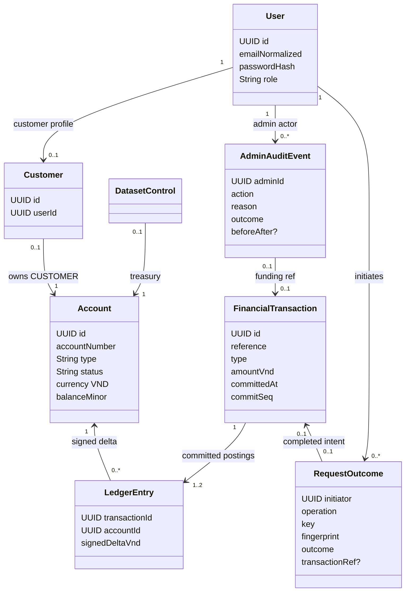
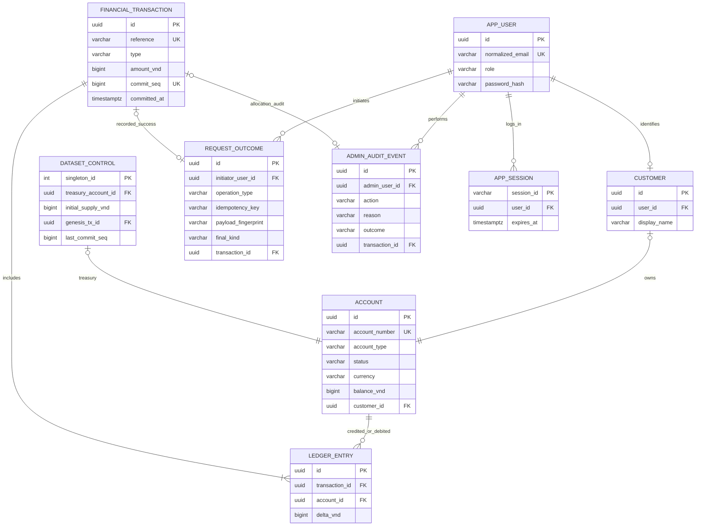
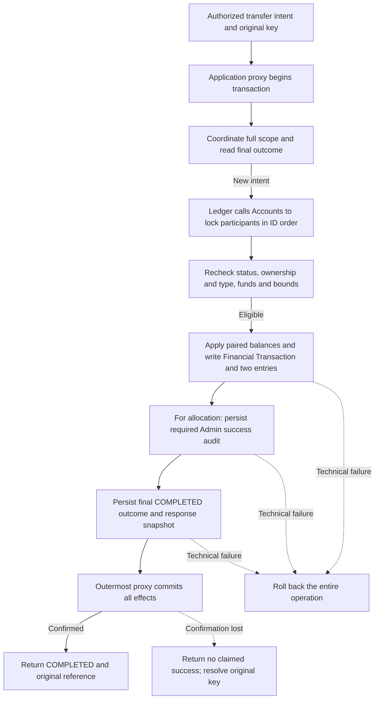
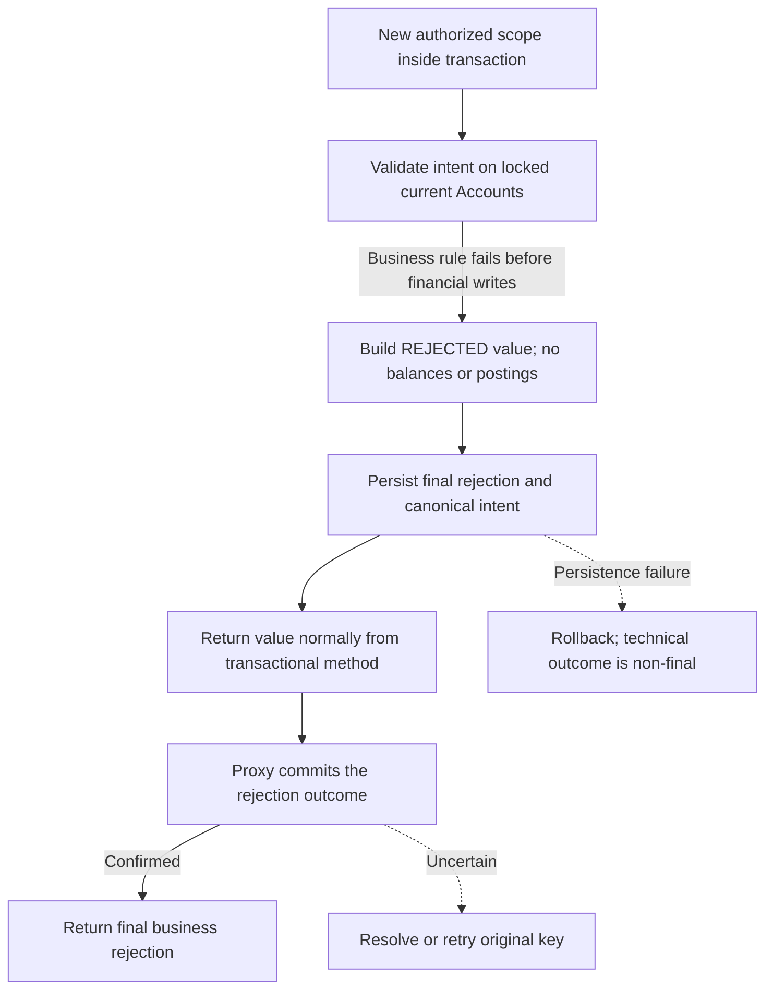

# 16 — Domain Model, ERD, PostgreSQL Data and Invariants

> Status: **PROPOSED technical design**, not a database already deployed. Approved semantics: [glossary 02](../01-discovery/02-domain-glossary.md), [rules 06](../01-discovery/06-business-rules.md), [PRD 09 §6–§7](../02-requirements/09-product-requirements.md). Names/columns/SQL types are engineering proposals. No full General Ledger is implied.

## 1. Domain relationships

`FinancialTransaction` has exactly **two** linked entries for `INTERNAL_TRANSFER`/`DEMO_ALLOCATION` and exactly **one positive treasury entry** for `GENESIS`. A final business rejection has a `RequestOutcome` but **zero Financial Transactions**. This is cardinality based on transaction type; it is not one optional entry for rejected requests.

## 2. Logical ERD

Note: Mermaid cardinalities describe conceptual relationships; specific optional foreign keys and unique constraints below are authoritative for proposed relational implementation. `DATASET_CONTROL` is a singleton that references Treasury; initialization transaction creates the pair atomically. Sessions may instead be managed using framework-owned session tables.

## 3. Proposed tables and key constraints

| Table | Columns / uniqueness (illustrative) | Invariant enforced |
|---|---|---|
| `app_user` | UUID PK; `email_normalized` UNIQUE NOT NULL; `role` CUSTOMER/ADMIN; password hash | No case-insensitive duplicate registration, no self-assigned ADMIN |
| `customer` | UUID PK; UNIQUE `user_id` FK; display_name | One Customer identity per registered Customer User |
| `account` | UUID PK; UNIQUE `account_number`; `customer_id` nullable FK with UNIQUE; `account_type`; `status`; `currency='VND'`; `balance_vnd BIGINT CHECK >=0` | CUSTOMER has exactly one owner; TREASURY is system-owned; no negative balance |
| `dataset_control` | singleton PK (=1); UNIQUE `treasury_account_id`; UNIQUE `genesis_tx_id`; immutable initial supply; `last_commit_seq` | One supply and one Treasury linkage; globally serialized posting order (proposal) |
| `financial_transaction` | UUID PK; UNIQUE immutable `reference`; UNIQUE `commit_seq`; type enum; amount BIGINT CHECK >0; `committed_at` | Financial facts only when committed; exact ordinary/GENESIS cardinality checked in posting layer and tests |
| `ledger_entry` | UUID PK; FK tx/account; `delta_vnd BIGINT CHECK <>0`; UNIQUE `(transaction_id, account_id)` | No duplicate account entries in one ordinary transfer; GENESIS exception has one positive entry |
| `request_outcome` | UNIQUE (`initiator_user_id`,`operation_type`,`idempotency_key`) with all three NOT NULL; canonicalization version, canonical intent, fingerprint, final kind and response snapshot; nullable tx FK; rejection code | Scope lifetime uniqueness and immutable final result; technical failure never final rejection |
| `admin_audit_event` | UUID PK; admin FK; action; target; reason; timestamp; outcome; tx FK or state-before/after | Complete success audit atomically persisted with funding/status change |
| `app_session` | framework-managed session ID, authenticated principal, expiry/revocation | Server-side termination prevents reuse |

**Enforcement notes:** CHECK/FOREIGN KEY/UNIQUE constraints are necessary but not sufficient for cross-row rules. The financial application transaction must enforce entry count/zero-sum, reconciliation, no stale status, and the exactly-one genesis. Consider deferred database constraint triggers as defense in depth for immutable posting cardinality; use migrations and invariants tests. Deny normal UPDATE/DELETE on immutable fact tables by code and least-privileged DB access; a DB trigger can further enforce append-only behavior.

## 4. Monetary representation (design recommendation)

- VND as **signed 64-bit integer** `BIGINT` / Java `long` (no decimal/floating-point). Positive `amountVnd` within 1..9,223,372,036,854,775,807, with safe signed negative delta. Use `Math.addExact` / `Math.subtractExact` (or checked `BigInteger` intermediates) before every result; reject invalid/out-of-range values.
- JSON amount should use a **decimal string containing digits only** (for example `"200000"`) to preserve precision for JavaScript browsers; API domain name `amountVnd`. Browser inputs parse whole-VND decimal strings, never `Number` for monetary arithmetic. This is a **proposed contract**, not a change from integer-valued VND domain semantics.
- No artificial commercial transfer cap; available balance and representable range still apply. Default GENESIS 100,000,000 VND can be replaced by a valid amount only before creation.

## 5. Transaction boundaries and outcomes (ARC-02)

**PROPOSED realization of mandatory atomicity.** Ownership and API allowlists are defined once in [15 §3](15-system-architecture.md#3-module-ownership-and-the-controlled-posting-path). Every financial entry uses one PostgreSQL database and transaction manager. No cross-module network calls or asynchronous financial commits are involved.

| Application entry point (illustrative name) | Transaction contents | Commit boundary |
|---|---|---|
| Transfers `ExecuteTransfer` | Scope coordination; final-result replay/conflict or locked validation; Ledger posting through Accounts; durable final outcome | Outermost application transaction, before HTTP serializes a final result |
| Administration `AllocateDemoFunds` | Same controlled posting path, with Treasury and recipient locks; required success audit and final outcome | Same transaction as balances, Financial Transaction and both Ledger Entries |
| Administration `ChangeAccountStatus` | Lock Account; validate reason/status; status change and complete required audit | One transaction; failure of audit persistence rolls back status |
| Identity `RegisterCustomer` | User, Customer and exactly one zero-balance Account through module APIs | One registration transaction; no partial provisioning |
| Bootstrap `InitializeDataset` | Single Treasury, finite supply, special GENESIS entry/reference and dataset control | One protected initialization transaction; existing dataset is verified, never reseeded on restart |

### 5.1 Spring transaction contract

Place `@Transactional` at the externally invoked application use-case entry, with **REQUIRED** propagation and the reviewed isolation/rollback policy. Collaborators join that transaction through the same transaction manager/data source. The restricted Ledger/Accounts mutation entry must require an existing transaction (for example `MANDATORY` as a guard); it must never silently commit a standalone debit. Domain objects need no transaction annotations. Do not use `REQUIRES_NEW` for ledger, balance, outcome or required Admin success audit: it would permit independently committed pieces. See [Spring propagation semantics](https://docs.spring.io/spring-framework/reference/data-access/transaction/declarative/tx-propagation.html).

In proxy-based Spring transactions, the controller calls the application bean through its proxy. Self-invocation does not create the intended intercepted boundary. The target method returns a pending result; the proxy commits before returning control to the caller. Thus returning from the method body or flushing JPA is **not** confirmation of commit. Keep HTTP response creation after the proxy returns successfully; test the actual proxy wiring rather than invoking the class directly. See [Spring transaction interception](https://docs.spring.io/spring-framework/reference/data-access/transaction/declarative/annotations.html).

Technical/persistence failures must escape the transactional boundary with rollback semantics. Spring's default rollback covers unchecked exceptions/errors, not every checked exception; configure explicit rollback for checked technical failures or translate them consistently. Never catch a failed SQL write inside the transaction and continue as though it succeeded, and never return success from a rollback-only transaction. A bounded retry runs **outside** the transactional proxy and invokes a fresh transaction. See [Spring rollback rules](https://docs.spring.io/spring-framework/reference/data-access/transaction/declarative/rolling-back.html).

The durable-commit premise also needs explicit PostgreSQL configuration: retain `fsync=on`, `full_page_writes=on` and synchronous local WAL flush (`synchronous_commit=on` for this single-database proposal), with persistent storage for financial facts, outcomes and required audits. Do not disable durability to make a benchmark pass. Record and verify the actual configuration during restart/crash tests; confirming a transaction on a configuration that can lose acknowledged commits does not satisfy the promised final outcome. This is an implementation safeguard for existing durability requirements, not a production HA commitment. See [PostgreSQL WAL and commit settings](https://www.postgresql.org/docs/18/runtime-config-wal.html).

### 5.2 Success and final rejection flows

Reject before applying either balance change. A final business rejection is an application result value, not an exception thrown through the transaction that would erase its stored outcome. All money/status/funds checks must finish before writes; a later technical failure or constraint surprise rolls back the operation instead of being recast as a final rejection after partial writes. Previously committed rejections are replayed without rechecking mutable eligibility.

| Situation | Persisted final outcome | Client-visible meaning |
|---|---|---|
| Confirmed financial commit | COMPLETED with immutable original reference/response | Success; one committed movement |
| Confirmed business rejection commit | REJECTED with stable reason/response; no transaction link | Final refusal; new business attempt needs a new key |
| Confirmed rollback/crash before commit | No new final record or financial effects | Technical failure; same key can safely recover/retry |
| Commit acknowledgement lost | May be COMPLETED/REJECTED, or absent | UNKNOWN to caller; consult the authoritative database through same-scope recovery |
| Duplicate still waiting | Original operation may be active | PROCESSING only with evidence of that intent; otherwise UNKNOWN; neither is a persisted final outcome |

The success audit, posting, balance changes and final outcome of allocation are indivisible. Freeze/unfreeze likewise cannot become effective without its required audit. Same-status requests return UNCHANGED without financial movement; optional attempted-operation audit is separate from a successful state-change audit. Security/operational rejection logs are not financial postings and must not determine the financial outcome.

## 6. Locking and isolation discipline (ARC-03)

**Main proposal: pessimistic PostgreSQL row locking at READ COMMITTED**, conditional on every mutation path following this protocol:

1. Establish authorized initiator and operation, then acquire idempotency-scope coordination (§7). Resolve an existing final result before testing changeable balances/statuses.
2. Determine the complete participant set using immutable Account IDs. Lock Accounts sequentially in one globally defined ascending ID order with `SELECT ... FOR UPDATE`, irrespective of debit/credit direction. Specify UUID byte ordering consistently across callers; do not rely on incidental query plan order or inconsistent Java UUID comparisons. Do not acquire Accounts incrementally in source-first order.
3. Reload and check **both locked current rows**: type, ownership where applicable, VND, ACTIVE, available funds and safe resulting balances. A pre-lock display balance/status is never authority to spend. Allocation includes Treasury and the Customer Account in the same sorted set. No caller supplies an arbitrary treasury source.
4. For eligible postings, acquire/update the singleton `dataset_control` row **after** all participant locks, assign `commit_seq`, and finish writes plus required audit/outcome. Hold all locks through commit/rollback. Keep this final section short; no HTTP, user interaction or external work inside it. Do not request additional Account/scope locks after acquiring the global row.
5. Freeze/unfreeze acquires the same target Account row lock and commits status+audit together. It does not need a financial sequence or funding key. If freeze wins, waiting transfer/funding rechecks FROZEN and rejects; if movement wins, it may commit before freeze. Failed freeze audit rolls back the freeze. Unfreeze follows the same ordering. This preserves the approved effective-state rules without retroactively reversing a movement.

Opposite-direction transfers lock the same pair in the same order. Competing debits serialize on the source; a later transaction sees the committed remainder and rejects if funds are insufficient. Concurrent allocations serialize at Treasury, even with distinct target Customers. These properties rely on transactions being short and all mutation paths obeying the protocol; no fairness or unlimited-throughput guarantee follows.

PostgreSQL holds row locks until transaction end, and a waiter can lock the newer row after its predecessor finishes. Transaction-scoped advisory locks also end with the transaction. These features support the proposed protocol; they do not make authorization automatic. See [PostgreSQL explicit locking](https://www.postgresql.org/docs/18/explicit-locking.html).

At READ COMMITTED, use a **new statement after acquiring coordination** to read a final outcome; do not combine a waiting lock function and outcome lookup into one statement whose snapshot predates the wait. Locked Account rows protect local state checks; global supply is preserved by paired atomic movements and controlled GENESIS, not by a concurrent unlocked sum check. Uniqueness constraints protect absent-row races (Account ownership, full key, singleton GENESIS). READ COMMITTED is not sufficient for arbitrary new cross-row predicates; any future invariant requires its own analysis. See [PostgreSQL isolation behavior](https://www.postgresql.org/docs/18/transaction-iso.html).

**Constraint backstops:** NOT NULL full scope fields; unique full scoped key, Account number and Customer ownership; valid account type/owner combinations; nonnegative bounded balances; positive transaction amounts; immutable unique reference/sequence; entry FK and `(transaction_id,account_id)` uniqueness; singleton dataset and GENESIS linkage. Cross-row entry counts/zero sum still require posting validation and reconciliation; a unique constraint alone does not enforce them. Exactly-one initialization must also withstand concurrent setup when no control row yet exists, using a unique singleton plus one atomic protected setup transaction. A losing initializer rolls back all of its own rows and then verifies the committed dataset. Restart/configuration mismatch must never reseed.

**Deadlocks/timeouts:** consistent Account ordering reduces deadlocks, but foreign keys, unique indexes and other locks can still produce them. Treat deadlock (`40P01`), serialization failure (`40001`, if encountered), and lock-unavailable/timeout (`55P03`) as technical failures. Roll back and release the transaction; never continue using an aborted connection transaction. A cancellation/connection failure requires diagnosis rather than blanket classification as a business rejection. Retry the entire original intent in a fresh transaction with the **same key**, bounded attempts, backoff/jitter and a request deadline. Proposed retry limits/timeouts must be measured and ratified; exhaustion returns non-final technical uncertainty. Do not blindly retry deterministic constraints or corrupt data. On an outcome-key unique violation, roll back the entire attempted posting, then coordinate/reread the winner; never suppress the error and commit partial effects.

Actual deadlock, timeout, freeze and opposite-direction schedules must run against real PostgreSQL, as specified in [22](../05-verification/22-test-strategy-and-acceptance.md). No such execution is claimed here.

## 7. Idempotency and recovery (ARC-04)

### 7.1 Durable identity and canonical intent

The full identity is `(initiator_user_id, operation_type, idempotency_key)`, with a durable **NOT NULL + UNIQUE** constraint across all three fields. The server derives initiator and operation; the key is opaque and case-sensitive, with no silent trimming or automatic reuse. Final records survive for the entire dataset lifetime. Key length/input-size bounds remain API-hardening decisions to review; they must not truncate keys into collisions.

Proposed canonicalization version `v1`:

- Parse a structurally recognizable request after authentication/CSRF/role/resource checks. Use a fixed, documented field order and deterministic UTF-8 JSON encoding, independent of input JSON property order/whitespace. Reject ambiguous duplicate JSON property names and unsupported fields before accepting the intent.
- Include operation, server-derived source Account ID, exact destination Account number, currency VND, amount, and every meaningful note/reason field. Allocation includes the server-selected Treasury ID and target Account number. Do not resolve a recipient into a mutable display name. An unknown recipient can still yield a reproducible rejected intent.
- Valid money has a canonical integral decimal-string representation consistent with the contract; never convert through floating point or change monetary value. For structurally identifiable requests with invalid monetary strings, encode the exact typed input in a tagged invalid-value representation so that final numeric rejections are replayable and distinct invalid values cannot collide through coercion. Malformed/unreadable JSON is a protocol error, not a committed financial intent.
- Preserve note/reason text exactly; do not silently trim, case-fold or Unicode-normalize it. Encode omission distinctly from an explicitly empty value; do not substitute current time, display names or changing account status into the payload. A changed note/reason is a different payload for this technical proposal.
- Fingerprint `version + canonical bytes` using SHA-256. Persist the version, canonical intent (with bounded non-secret fields), fingerprint and final result. Compare exact canonical intent as well as the digest; a digest match alone must not merge different intents. Retain old canonicalization readers when evolving the format so old keys still replay.

Canonicalization is a technical recommendation requiring frontend/backend review, not a new banking policy. It must have fixed test vectors for reordered JSON, changed amount/recipient/note/reason, omitted/empty fields, invalid money, operation/initiator separation and version upgrades. Credentials, cookies and passwords are never stored in the canonical intent. Rejected outcomes store stable business reason/response; completed outcomes store the original immutable transaction reference and response snapshot, not a regenerated reference or current balance.

### 7.2 Coordination alternatives and recommendation

| Strategy | Coordination and failure behavior | Trade-off |
|---|---|---|
| **Transaction-scoped advisory lock + final-only outcome row (recommended, PROPOSED)** | Deterministically map the full scope into a namespaced 64-bit advisory-lock key; acquire inside the outer transaction before reading outcomes. A new SQL statement reads the authoritative primary after lock acquisition. Full-field uniqueness and canonical comparison remain mandatory. Crash/rollback releases the lock and leaves no final record. | Small design without a persisted processing lifecycle; all writers/recovery paths must honor it. Hash collisions serialize unrelated scopes but never authorize replay/conflict. Requires PostgreSQL-specific adapter and timeout/recovery tests. |
| Unique intent record + transactional coordination | Insert a unique full-scope intent claim, wait on conflict, then reread/lock the existing row in a fresh statement. Claim, postings and final result must commit together; a losing insert cannot proceed to post. | Relies on unique-index conflict behavior; needs explicit claim/schema handling and verification of insert/read snapshots. A separately committed PROCESSING claim would add leases/recovery and is not this proposal. |

Do not use `SELECT ... FOR UPDATE` on a missing outcome as a mutex: a nonexistent row is not locked. In the recommended strategy, advisory coordination is part of the correctness protocol, not merely an optional performance optimization. The database unique full key is the final defense; its violation rolls back **all** effects of the loser. Use transaction-scoped rather than session-scoped advisory locks so pooled connections cannot retain an intent lock after rollback.

A duplicate waits within a bounded budget. If waiting expires, end/roll back the waiting transaction and respond non-final; it may safely retry the same key. Report PROCESSING only if the **full scope** is known to be executing; advisory hash contention alone is insufficient evidence. Otherwise report UNKNOWN. Never persist PROCESSING or UNKNOWN as an immutable final result. Different payloads using the same scope also coordinate first; once a final intent is known, return conflict without changing it.

### 7.3 Required recovery cases

| Case | Required behavior under the proposal |
|---|---|
| 1. Same key/payload, completed | Authorize, coordinate, compare canonical intent, replay original reference/response; no new posting |
| 2. Same key, changed payload | Conflict after exact comparison; preserve original intent/result; no balance change |
| 3. Same key, final rejection | Replay original rejection even after later funding/unfreeze; new attempt needs new key |
| 4. Concurrent duplicates | Only the scope holder may newly execute; duplicate waits or receives non-final response; eventual same result |
| 5. Crash before commit | Transaction rollback leaves no partial ledger/balance/audit/final outcome; original key may execute safely after coordination |
| 6. Crash after commit, response lost | Durable outcome and original transaction reference recover the result; no second movement |
| 7. Timeout/unknown commit | Retain key and original payload; use authorized lookup or same-key retry, never infer failure from client timeout |
| 8. Unauthorized lookup/replay | Check current role/resource authorization before exposing the stored outcome; frozen ownership alone does not revoke read/replay access |
| 9. Missing/unavailable outcome | Absence on an unsynchronized read or replica is not proof of failure; remain non-final and resolve against the authoritative primary |
| 10. Dataset lifetime | No TTL deletion or same-scope key reuse; restarts preserve both successful and rejected outcomes |

For a retry with no known final record, reacquire the same coordination lock in a new transaction and **then** read committed state from the primary in a new statement. This waits out any earlier transaction in that scope. Under atomic posting+outcome and unchanged coordination, absence at that point permits safe execution of the original intent. It does not justify telling a client to invent a new key after an uncertain response. A lookup-only operation may return an authorized stored final result; if none is visible it remains a non-final observation (even when transported as a safe 404), not a financial-failure verdict. If the primary is unavailable, keep the outcome UNKNOWN. Database backup/restore procedures must preserve postings and outcomes together; partial restoration invalidates the guarantee.

The correctness argument is conditional: full-scope coordination serializes attempts; final-only lookup decides replay/rejection/conflict before posting; every new financial effect and final outcome commits atomically; uniqueness rolls back any unexpected loser; recovery repeats this same protocol. Validate these premises with the small [PostgreSQL proof-of-concept in 22](../05-verification/22-test-strategy-and-acceptance.md#postgresql-idempotency-proof-of-concept-arc-04), not an in-memory substitute.

## 8. History ordering and global sequence risk (ARC-05)

**Retained PROPOSED design:** Ledger owns `dataset_control.last_commit_seq`, advanced transactionally once per committed Financial Transaction, including controlled GENESIS. Final rejections, replay/conflict and freeze do not allocate a financial position. Increment only after participant validation/locks and hold the row lock until commit. A rollback also rolls back the increment. This serializes the commit tail of otherwise disjoint financial operations.

A first history page captures a committed high-water sequence `H` and reads only authorized immutable movements with `commit_seq <= H`, ordered by `commit_seq DESC`. Continuations use `commit_seq < last_seen` within that same bound. Bind the opaque integrity-protected cursor to owner/account, `H`, last position and paging constraints; enforce default 20/max 100 and current authorization on every page. A new traversal sees newer movements; an existing traversal stays stable. `committedAt` is an informational posting timestamp, not a substitute for the order token or a promise of the database's exact physical commit instant.

Because the next sequencer holder cannot proceed until the previous posting commits/rolls back, a later commit cannot insert an earlier position under a captured committed bound. Read the initial bound/page in one statement or a consistent read-only snapshot. Do not hold a database transaction open across browser page requests. Immutable facts and retention keep continuation valid; no customer gains visibility of another Account or rejected request.

A plain PostgreSQL `nextval()` allocates unique values without holding transactions in commit order. For example, transaction A takes 41 and stalls; B takes 42 and commits; a reader takes bound 42; A later commits 41. That row can appear behind an already-consumed cursor or be omitted. A timestamp plus random ID has the same late-commit problem. The failure is ordering, not just gaps. See [PostgreSQL sequence semantics](https://www.postgresql.org/docs/18/functions-sequence.html).

| Alternative | Correctness condition and trade-off |
|---|---|
| Keep transactional global counter | Simple common order for Customer/Admin financial history; global row can constrain throughput and amplify account-lock hold times |
| Per-Account ordered positions | Uses already-locked Accounts for participant histories; requires two positions per ordinary transaction and a separate design for Admin cross-account history/cursors; not a drop-in global-sequence replacement |
| Materialized history snapshot | Store the authorized ordered reference set at first page; stable membership, but storage/expiry/cleanup and snapshot lifecycle must be defined |
| Commit-ordered projection/log | Consume actual committed order and build a read projection with a proven watermark; extra lag/recovery/operational complexity, deferred unless justified |

None is selected as a replacement. A SQL sequence alone, naive OFFSET paging or timestamp-only ordering does not preserve the current snapshot proposal. Optional future projection work does not require a message broker or event sourcing in V1.

**Measurement plan:** run the unchanged [PRD §9 benchmark](../02-requirements/09-product-requirements.md) first. In separate diagnostic runs, compare disjoint Account pairs, one hot debit Account, duplicate-key fan-in and Treasury allocations with fixed fixtures. Sweep 10/25/50/100 requests per second only as resource capacity permits; these are diagnostic loads, not extra V1 acceptance targets. Record offered/achieved throughput, p50/p95/p99 request and transaction latency, timeout/deadlock/retry counts, and separate scope-lock, Account-lock and global-counter wait/hold durations. Correlate application timing with PostgreSQL lock/wait observations, CPU/I/O and commit/WAL latency; retain environment/version, test revision, workload and reconciliation evidence. All runs require zero invariant violations.

**Revisit TD-004/014** if the baseline misses its target with counter contention as a demonstrated material contributor, or diagnostics show the serialized commit tail limits the agreed expected workload. Do not blame the counter solely from aggregate latency: isolate Account/Treasury contention and infrastructure limits. Any alternative must pass identical late-commit pagination, crash/recovery and reconciliation checks before replacement. No contention measurements or bottleneck finding exist yet.

## 9. Reconciliation query principles

- On one consistent committed snapshot (one statement or read-only REPEATABLE READ transaction), compare each Account balance to its committed signed-entry sum, zero if empty; include GENESIS once. Independent READ COMMITTED queries during writes could report a false mismatch.
- Verify total Treasury plus Customer balances equals the immutable initial supply; exactly one committed GENESIS and Treasury; exactly two equal-and-opposite entries for every ordinary Financial Transaction.
- Verify each completed funding reference has its required audit; rejected outcomes link to no posted transaction; final outcomes reference the corresponding immutable financial facts and remain unique in full scope.
- Run after fault, concurrency, restart, initialization and performance tests. Diagnostic reconciliation is not a new financial reporting product or a repair/mint API.

## 10. Design topics requiring review

- TD-015/016: restricted Ledger posting ownership and API/method allowlists; transaction participation guards and protection against uncontrolled repository access.
- TD-002/003: UUID lock comparator, READ COMMITTED premises, canonicalization version/field behavior, advisory-key mapping, retry budgets and proof-of-concept results.
- TD-004/014: history snapshot/cursor contract and counter-contention evidence; no alternative selected without correctness evidence.
- Audit before/after schema, stable rejected response snapshot, Account-number generator, immutable-table safeguards and indexes remain implementation details to review.
- Failure-safe Treasury/dataset/GENESIS linkage may require deferred foreign keys or carefully ordered initialization within one transaction. Verify concurrent initialization and restart without reseeding.
- Compatible Spring Boot/Spring transaction manager/JPA choices and PostgreSQL major version must be recorded before implementation. This document specifies no migrations or application classes.
