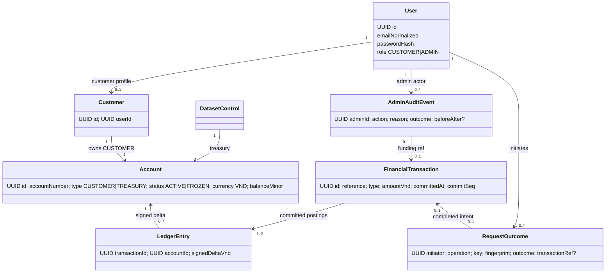

# 16 — Domain Model, ERD, PostgreSQL Data and Invariants

> Status: **PROPOSED technical design**, not a database already deployed. Approved semantics: [glossary 02](../baseline/02-domain-glossary.md), [rules 06](../baseline/06-business-rules.md), [PRD 09 §6–§7](../baseline/09-product-requirements.md). Names/columns/SQL types are engineering proposals. No full General Ledger is implied.

## 1. Domain relationships



`FinancialTransaction` has exactly **two** linked entries for `INTERNAL_TRANSFER`/`DEMO_ALLOCATION` and exactly **one positive treasury entry** for `GENESIS`. A final business rejection has a `RequestOutcome` but **zero Financial Transactions**. This is cardinality based on transaction type; it is not one optional entry for rejected requests.

## 2. Logical ERD

```mermaid
 erDiagram
  APP_USER ||--o| CUSTOMER : identifies
  CUSTOMER ||--|| ACCOUNT : owns
  DATASET_CONTROL ||--|| ACCOUNT : treasury
  ACCOUNT ||--o{ LEDGER_ENTRY : credited_or_debited
  FINANCIAL_TRANSACTION ||--|{ LEDGER_ENTRY : includes
  APP_USER ||--o{ REQUEST_OUTCOME : initiates
  FINANCIAL_TRANSACTION o|--o| REQUEST_OUTCOME : recorded_success
  APP_USER ||--o{ ADMIN_AUDIT_EVENT : performs
  FINANCIAL_TRANSACTION o|--o| ADMIN_AUDIT_EVENT : allocation_audit
  APP_USER ||--o{ APP_SESSION : logs_in
  APP_USER {uuid id PK; varchar normalized_email UK; varchar role; varchar password_hash}
  CUSTOMER {uuid id PK; uuid user_id FK; varchar display_name}
  ACCOUNT {uuid id PK; varchar account_number UK; varchar account_type; varchar status; varchar currency; bigint balance_vnd; uuid customer_id FK}
  DATASET_CONTROL {int singleton_id PK; uuid treasury_account_id FK; bigint initial_supply_vnd; uuid genesis_tx_id FK; bigint last_commit_seq}
  FINANCIAL_TRANSACTION {uuid id PK; varchar reference UK; varchar type; bigint amount_vnd; bigint commit_seq UK; timestamptz committed_at}
  LEDGER_ENTRY {uuid id PK; uuid transaction_id FK; uuid account_id FK; bigint delta_vnd}
  REQUEST_OUTCOME {uuid id PK; uuid initiator_user_id FK; varchar operation_type; varchar idempotency_key; varchar payload_fingerprint; varchar final_kind; uuid transaction_id FK}
  ADMIN_AUDIT_EVENT {uuid id PK; uuid admin_user_id FK; varchar action; varchar reason; varchar outcome; uuid transaction_id FK}
  APP_SESSION {varchar session_id PK; uuid user_id FK; timestamptz expires_at}
```

Note: Mermaid cardinalities describe conceptual relationships; specific optional foreign keys and unique constraints below are authoritative for proposed relational implementation. `DATASET_CONTROL` is a singleton that references Treasury; initialization transaction creates the pair atomically. Sessions may instead be managed using framework-owned session tables.

## 3. Proposed tables and key constraints

| Table | Columns / uniqueness (illustrative) | Invariant enforced |
|---|---|---|
| `app_user` | UUID PK; `email_normalized` UNIQUE NOT NULL; `role` CUSTOMER/ADMIN; password hash | No case-insensitive duplicate registration, no self-assigned ADMIN |
| `customer` | UUID PK; UNIQUE `user_id` FK; display_name | One Customer identity per registered Customer User |
| `account` | UUID PK; UNIQUE `account_number`; `customer_id` nullable FK with UNIQUE; `account_type`; `status`; `currency='VND'`; `balance_vnd BIGINT CHECK >=0` | CUSTOMER has exactly one owner; TREASURY is system-owned; no negative balance |
| `dataset_control` | singleton PK (=1); UNIQUE `treasury_account_id`; UNIQUE `genesis_tx_id`; immutable initial supply; `last_commit_seq` | One supply and one Treasury linkage; globally serialized posting order (proposal) |
| `financial_transaction` | UUID PK; UNIQUE immutable `reference`; UNIQUE `commit_seq`; type enum; amount BIGINT CHECK >0; `committed_at` | Financial facts only when committed; exact ordinary/GENESIS cardinality checked in posting layer and tests |
| `ledger_entry` | UUID PK; FK tx/account; `delta_vnd BIGINT CHECK <>0`; UNIQUE `(transaction_id, account_id)` | No duplicate account entries in one ordinary transfer; GENESIS exception has one positive entry |
| `request_outcome` | UNIQUE (`initiator_user_id`,`operation_type`,`idempotency_key`); fingerprint and final kind; nullable tx FK; rejection code | Scope lifetime uniqueness and immutable final result; technical failure never final rejection |
| `admin_audit_event` | UUID PK; admin FK; action; target; reason; timestamp; outcome; tx FK or state-before/after | Complete success audit atomically persisted with funding/status change |
| `app_session` | framework-managed session ID, authenticated principal, expiry/revocation | Server-side termination prevents reuse |

**Enforcement notes:** CHECK/FOREIGN KEY/UNIQUE constraints are necessary but not sufficient for cross-row rules. The financial application transaction must enforce entry count/zero-sum, reconciliation, no stale status, and the exactly-one genesis. Consider deferred database constraint triggers as defense in depth for immutable posting cardinality; use migrations and invariants tests. Deny normal UPDATE/DELETE on immutable fact tables by code and least-privileged DB access; a DB trigger can further enforce append-only behavior.

## 4. Monetary representation (design recommendation)

- VND as **signed 64-bit integer** `BIGINT` / Java `long` (no decimal/floating-point). Positive `amountVnd` within 1..9,223,372,036,854,775,807, with safe signed negative delta. Use `Math.addExact` / `Math.subtractExact` (or checked `BigInteger` intermediates) before every result; reject invalid/out-of-range values.
- JSON amount should use a **decimal string containing digits only** (for example `"200000"`) to preserve precision for JavaScript browsers; API domain name `amountVnd`. Browser inputs parse whole-VND decimal strings, never `Number` for monetary arithmetic. This is a **proposed contract**, not a change from integer-valued VND domain semantics.
- No artificial commercial transfer cap; available balance and representable range still apply. Default GENESIS 100,000,000 VND can be replaced by a valid amount only before creation.

## 5. Transaction and locking proposal

1. Authenticate and authorize current caller. Normalize and fingerprint canonical intent. Coordinate the idempotency *scope* (e.g. PostgreSQL transaction-scoped advisory lock keyed by user/operation/key, followed by unique DB constraint and exact key check).
2. If key already finalized: verify fingerprint, return original result or conflict; do not revalidate mutable business status/balances.
3. If new: lock participating `account` rows in **deterministic UUID order** using `SELECT ... FOR UPDATE`, including Treasury for allocations; re-check ACTIVE, type, available balance, result bounds in the same DB transaction. Freeze/unfreeze uses compatible locks on target row.
4. For valid intent, use `dataset_control` transactional row update to assign an ordered **commit sequence** (see ADR-003). Insert `financial_transaction`, two ledger entries, update both balance values and final `request_outcome`; insert required funding success audit in the **same commit**. For rejected business intent, insert final rejection outcome without postings and commit it.
5. Respond `COMPLETED` only after confirmed DB commit. For unknown result, retry original key. Rollbacks do not persist posting or final success. Stable participant/treasury labels in receipts must not leak restricted details.
6. Status change commits `account.status` and success audit in one transaction. For same-status request, return `UNCHANGED` without any monetary posting.

The advisory lock is a **serialization optimization only**, not an authorization mechanism. Potential hash collisions cause unnecessary waiting; uniqueness of stored full scoped key is the correctness boundary. Large fan-in to `dataset_control` creates contention; measure against EV-003 and revise ADR if needed, preserving stable pagination and financial invariants.

## 6. Reconciliation query principles

- On one consistent committed snapshot, compare each `account.balance_vnd` to `SUM(ledger_entry.delta_vnd)` for that Account (zero if no entries); include GENESIS one time only.
- Verify `SUM(all Account balances) = dataset_control.initial_supply_vnd`; count exactly one committed GENESIS, one treasury account, and exactly two signed entries per ordinary Financial Transaction.
- Audit append-only rows, verify each completed funding reference links to required audit, and ensure rejected outcomes link to no posted transaction.
- Run after fault, concurrency, restart, initialization, and performance tests. Diagnostic reconciliation is not an extra customer-facing financial reporting product.

## 7. Design topics requiring review

- Schema for admin audit before/after fields, idempotency rejected response snapshot, referential checks requiring DEFERRABLE FK at GENESIS bootstrap, and exact account-number generator.
- Failure-safe initial two-way relationship between `dataset_control`, treasury account and genesis transaction (may make FK deferred, or initialize in ordered steps within a single transaction).
- Transaction key/fingerprint canonicalization and global commit sequence throughput. Document indexes and query EXPLAIN results after running benchmark; no performance claim is made here.
