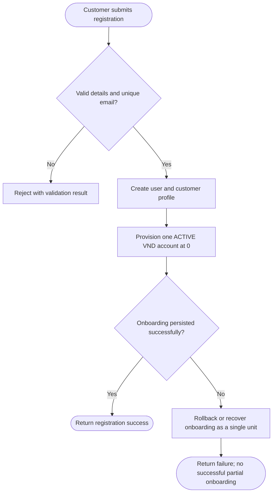
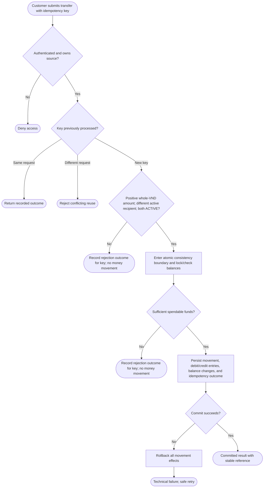
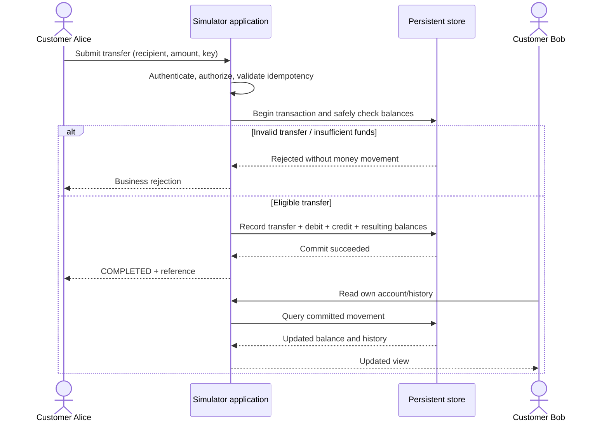
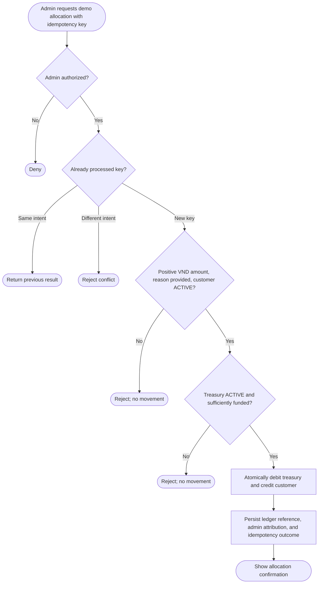
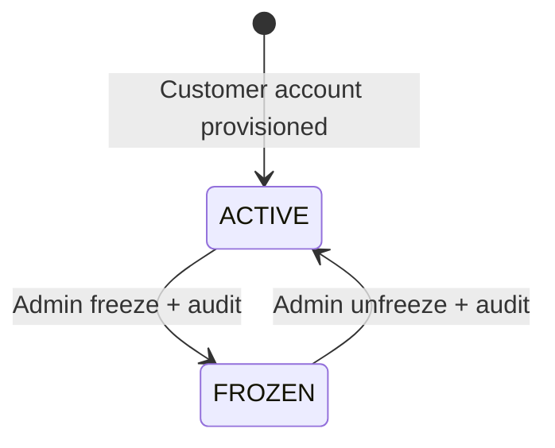

# 05 — Business Process Flows

> **Stage:** Phase 1 — Domain Discovery  
> **Status:** Working draft — conceptual business flows, not physical architecture  
> **Version:** 0.1 | **Last updated:** 2026-10-14

## 1. Purpose

Visualize the key **end-to-end behaviors** the team must understand before designing APIs and services. Mermaid diagrams are stored as source-controlled text. The **System** participant represents logical application responsibilities; no microservice boundaries are implied.

## 2. BP-01 — Registration and account provisioning

**Use case:** `UC-AUTH-01`  
**Outcome:** A registered customer has exactly one ACTIVE VND account, initially holding zero virtual funds.



**Key rules:** `BR-ID-01`, `BR-ID-02`, `BR-ACC-01`. The technical design decides whether to use one database transaction or an equivalent controlled recovery procedure.

## 3. BP-02 — Customer-to-customer internal transfer

**Use case:** `UC-TRF-01`  
**Outcome:** Either a fully committed transfer, a valid business rejection, or a technical outcome the client can safely determine through idempotent retry.



The idempotency mechanism also records final business-rejection outcomes to make retries deterministic; how this is implemented is a technical-design decision. A **lost client response after successful commit** is not represented as a rollback: the money movement remains committed and the client must retry with the **same key**.

### Logical interaction sequence



**Critical invariant:** for an internal movement of `200000 VND`:

```text
Debit-side signed entry:   -200000 VND
Credit-side signed entry:  +200000 VND
Movement entry sum:               0 VND
```

This applies to both customer-to-customer transfers and treasury-to-customer allocations. It **does not** apply to the one-time treasury genesis event that initializes the simulated money pool.

**Key rules:** `BR-TRF-01`–`BR-TRF-09`, `BR-ACC-02`, `BR-ACC-03`. Active state and available funds are revalidated within the same concurrency-safe boundary used for commit.

## 4. BP-03 — Administrator demo fund allocation

**Use case:** `UC-ADM-02`  
**Outcome:** Transfer a positive amount **from** finite demo treasury **to** an ACTIVE customer account; log who authorized it and why. Require a retry-safe request key so double submissions cannot allocate twice.



**Initialization note:** On installation, the **treasury genesis** step creates a finite pool of *simulated* money exactly once and logs the initialized quantity. Ordinary allocations never adjust customer balances directly and cannot exceed the treasury's available balance. The technical design must make bootstrap repeat-safe.

**Key rules:** `BR-ADM-01`, `BR-ADM-02`, `BR-ADM-03`, `BR-ADM-04`, `BR-ACC-02`, `BR-ACC-03`.

## 5. BP-04 — Freeze and unfreeze customer account

**Use case:** `UC-ADM-03`  
**Outcome:** Account status changed with audit trail. Existing history remains readable; new inbound/outbound money movements are disallowed while FROZEN.



**Concurrency note:** Freeze/unfreeze and money movement must enforce a consistent ordering. If a freeze takes effect before transfer validation/commit, the transfer cannot commit. If the transfer commits first, the subsequent freeze does not undo history. The implementation strategy is decided in technical design.

**Key rules:** `BR-ACC-02`, `BR-ADM-03`.

## 6. BP-05 — History and audit visibility

**Use cases:** `UC-ACC-02`, `UC-TRF-02`, `UC-ADM-04`.

1. Customer authenticates and requests only **their own** account history.
2. Application authorizes account/transaction ownership.
3. Application projects immutable committed entries into a customer-friendly list of incoming/outgoing movements.
4. Admin audit views retrieve administrative actions (actor, timestamp, subject, action, outcome) separately from financial ledger history.
5. Failed authorization never reveals another customer's private transaction details.

**Key rules:** `BR-HIS-01`, `BR-HIS-02`, `BR-ADM-03`.

## 7. Boundary cases to discuss in design review

| Situation | Expected V1 business outcome |
|---|---|
| Two customer transfers spend same balance concurrently | Only transfers that fit actual available balance may commit |
| Response lost after successful commit | Retry same idempotency key; no second transfer |
| Source frozen during transfer | Commit order determines outcome; if freeze is effective first, reject transfer |
| Customer becomes frozen after a transfer | Previously committed transfer stays in history |
| Treasury runs out of demo funds | Admin allocation rejected without creating virtual money |
| Server crashes before transaction commits | No partial financial effects |
| Account history is empty | Show an empty state, not a fabricated transaction |

**Related:** [04 — Use Cases](./04-use-cases.md) · [06 — Business Rules](./06-business-rules.md)
